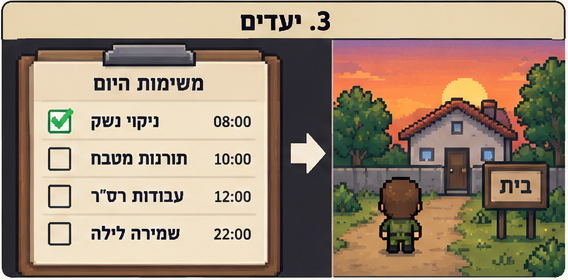
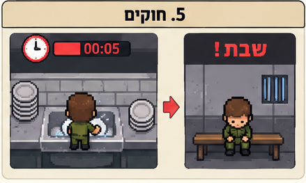
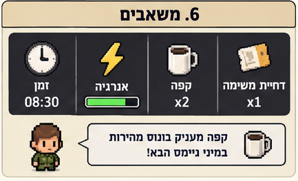
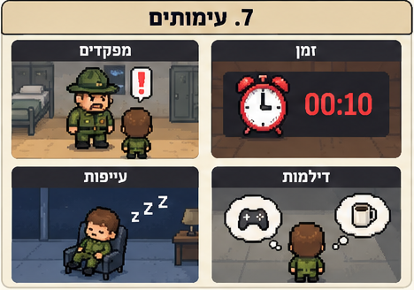
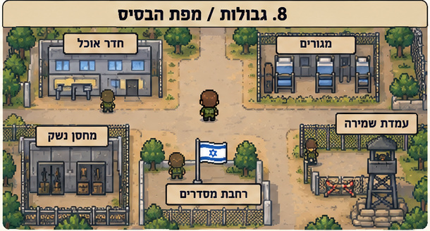
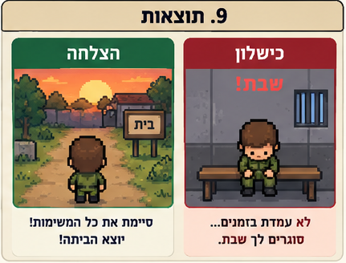
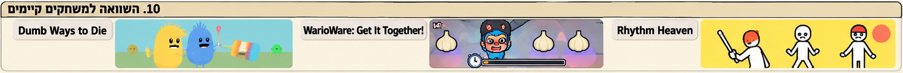

# Ad-Matai — עד מתי?

**Tagline: עוד משימה אחת הביתה... אלא אם כן תסגור שבת.**

## מהות המשחק

**Ad-Matai** הוא משחק הומוריסטי לשחקן יחיד שבו השחקן מגלם חייל המנסה לשרוד את היום האחרון בבסיס ולהספיק לצאת הביתה לפני כניסת השבת. כדי לקבל אישור יציאה, עליו לבצע סדרת מטלות צבאיות תחת לחץ זמן: ניקוי נשק, צחצוח נעליים, עבודות רס״ר, תורנות מטבח ושמירה לילית. כל מטלה הופכת למיני־גיים קצר בעל מכניקה שונה, בעוד טעויות ועיכובים עלולים לגרור משימות נוספות ואף את העונש הצבאי המוכר — סגירת שבת. ההומור נובע מהפער שבין המשימות היומיומיות והקטנות לבין הדרמה העצומה שהחייל מייחס לכל דקה בדרך הביתה.

**פלטפורמת יעד:** מחשב אישי (PC), עם שליטה באמצעות מקלדת ועכבר. המשחק מיועד לפיתוח ב־Unity.

**שפה חזותית:** אזור הסיור בבסיס יוצג כעולם דו־ממדי בסגנון Pixel Art, במבט מלמעלה או בזווית אלכסונית קלה. לעומתו, מסכי המיני־גיימס יהיו איורים דו־ממדיים נקיים, צבעוניים ומוגזמים בהשראת *Dumb Ways to Die* ו־*Rhythm Heaven*. המעבר בין הסגנונות יבדיל בין חיי הבסיס לבין רגעי האתגר.

**מקום לתמונה — מסך קונספט ראשי:** מפה מפוקסלת של בסיס צבאי עם חייל, מבנים, מפקד, סימוני משימות ושעון יציאה.

---

## רכיבים רשמיים

### 1. שחקנים

המשחק מיועד בעיקר לבני נוער ומבוגרים, בדגש על שחקנים שמכירים את ההומור של השירות הצבאי בישראל או נהנים ממשחקי מסיבה ומיני־גיימס קצרים. אין צורך בניסיון מוקדם במשחקי מחשב: הפקדים פשוטים, כל מיני־גיים מלמד פעולה אחת או שתיים, והקושי עולה בהדרגה. היכרות עם הצבא מוסיפה להומור, אך אינה הכרחית להבנת היעדים.

**מספר שחקנים:** שחקן יחיד. המפקדים, חיילים אחרים ואנשי הבסיס הם דמויות הנשלטות בידי המשחק (NPCs), ולא שחקנים אנושיים. האינטראקציה היא בין השחקן למערכת: קבלת הוראות, הגעה לעמדות משימה, ביצוע מטלות והתמודדות עם תוצאותיהן. אין בשלב זה מצב שיתופי או תחרותי.

**מקום לתמונה — השחקן ודמויות הבסיס:** חייל ראשי, מפקד ורס״ר בסגנון Pixel Art.

### 2. יעדים

**יעד העל:** לסיים את כל מטלות החובה ולהגיע לשער הבסיס בזמן, כדי לצאת הביתה לשבת.

בתחילת השלב החייל מקבל רשימת משימות ושעת יציאה מחייבת. לכל משימה מוצמדים מיקום בבסיס ותנאי השלמה; ביצוע מוצלח מסמן אותה ברשימה כמשימה שהושלמה. השחקן יכול לבחור את סדר הביצוע של חלק מהמשימות, בהתאם לזמינותן, ובכך לצמצם הליכה מיותרת ולנהל את הזמן.

**יעדי משנה לדוגמה:**
- לנקות את הנשק עד שמד הניקיון מגיע לסף הנדרש.
- לצחצח את הנעליים באופן אחיד לפני סיום הזמן.
- לנקות אזור שהרס״ר סימן לפני הביקורת.
- לשטוף כלים לפי קצב ודרישות התורנות.
- להישאר ער בשמירה עד לתום המשמרת בלי להיתפס נרדם.

**הצגת היעדים:** רשימת מטלות בפינת המסך, שעון בולט המציג את הזמן שנותר, סימוני מיקום על גבי המפה, והודעות קצרות מהמפקד. משימה שהושלמה תלווה בסימון ברור ובאפקט קולי משעשע.

**מקום לתמונה — ממשק היעדים:** רשימת משימות, שעון ומיקום שער היציאה.

### 3. תהליכים

**תהליך ההתחלה — 30 השניות הראשונות:** המשחק נפתח ביום שישי בבוקר. החייל מתעורר וחושב שסוף־סוף הגיע הזמן לצאת הביתה, אך מיד מופיע מפקד שמודיע: ״רק כמה דברים קטנים לפני שאתה יוצא״. השחקן מקבל רשימת משימות קצרה ושעון הסופר לאחור עד היציאה. בתוך שניות הוא מבצע משימת הדרכה פשוטה של צחצוח נעליים: הזזת העכבר על גבי הנעל עד שמד הברק מתמלא. הצלחה מהירה והתגובה הקומית של המפקד מלמדות את אופי המשחק ומובילות לסיור בבסיס.

**תהליך הליבה — לולאת המשחק:**

1. השחקן נע בבסיס באמצעות WASD או מקשי החצים, ומאתר משימה בעזרת רשימת המטלות או הסימון במפה.
2. הוא ניגש לתחנת המשימה ולוחץ E כדי להתחיל אותה.
3. מסך הסיור מתחלף במסך מיני־גיים מאויר, שבו מוצגים שם המשימה, הוראה קצרה, מד התקדמות ומגבלת זמן או טעויות.
4. השחקן מבצע את הפעולות באמצעות עכבר, מקלדת או שילוב שלהם, בהתאם למשימה.
5. בסיום מוצג משוב: הצלחה, הצלחה חלקית או כישלון. התוצאה משפיעה על סטטוס המשימה ועל הזמן שנותר.
6. השחקן חוזר למפת הבסיס, מתכנן את המשימה הבאה וממשיך עד שכולן הושלמו — או עד שאזלו לו האפשרויות לצאת בזמן.

**דוגמאות למיני־גיימס:**

| מיני־גיים | פעולה מרכזית | אתגר ותנאי הצלחה |
|---|---|---|
| ניקוי נשק | גרירת מטלית או מברשת בעכבר על חלקים מלוכלכים | לנקות את האזורים הנדרשים בזמן, בלי לפספס חלקים |
| צחצוח נעליים | תנועות עכבר מהירות ומדויקות על פני הנעל | למלא מד ברק ולהימנע משפשוף ממושך במקום אחד |
| עבודות רס״ר | תנועה עם מטאטא בין ערימות לכלוך באמצעות מקשים | לפנות מספיק לכלוך לפני שהרס״ר מגיע לביקורת |
| תורנות מטבח | לחיצות ותנועות קצרות לשטיפה ומיון כלים שמגיעים ברצף | לטפל בכלים בקצב עולה בלי לצבור עומס חריג |
| שמירה לילית | לחיצות מתוזמנות על מקש כדי לשמור על ערנות החייל המתנדנד בכיסא | לשמור את מד הערנות בתחום התקין עד סוף המשמרת |

**תהליך הסיום:** לאחר סיום מטלות החובה השחקן צריך להגיע פיזית לשער הבסיס. אם עמד בדרישות והגיע לפני שעת היציאה, המפקד מאשר את יציאתו והמשחק מסתיים בסצנה קומית של החייל רץ אל החופש. אם הזמן נגמר או שנצברו יותר מדי כישלונות, המפקד מודיע ״אתה סוגר שבת״ ומוצג מסך הפסד עם אפשרות לניסיון חוזר.

**למידת התהליכים:** הדרכה קצרה מוטמעת בתחילת המשחק. כל מיני־גיים מציג הוראה חזותית בת משפט אחד וסמל של הפקד הרלוונטי. ניסיונות ראשונים יהיו קלים יותר, והמשוב המיידי יעזור לשחקן ללמוד ללא צורך בקריאת הוראות ארוכות.

**מקום לתמונות — תהליך הליבה:** צילום מסך מהסיור בבסיס וצילומי קונספט של מיני־גיימס ניקוי נשק, צחצוח נעליים, עבודות רס״ר, מטבח ושמירה.

### 4. חוקים

- השחקן חייב להשלים את כל משימות החובה לפני שיוכל לקבל אישור לצאת דרך שער הבסיס.
- הזמן במשחק מוגבל. הוא מתקדם בעת הסיור ובמהלך המיני־גיימס; הזמן המוקצב נקבע לפי השלב ורמת הקושי.
- כל מיני־גיים מחייב ביצוע של פעולה מוגדרת לפי חוקיו, כגון דיוק, קצב, איזון או השלמת מד התקדמות.
- הצלחה מסמנת את המשימה כהושלמה. כישלון מחייב ניסיון חוזר, ובחלק מהמטלות עשוי לגרור עיכוב נוסף או משימת תיקון.
- אם מגיעה שעת היציאה כשהמשימות טרם הושלמו, השחקן נכשל וסוגר שבת.
- אין אפשרות לדלג על מטלת חובה או לעבור דרך קירות ואזורים חסומים של הבסיס.

**קביעת תוצאות:** הצלחה נמדדת לפי תנאים גלויים המתאימים למיני־גיים — למשל סף ניקיון, מספר כלים שהושלמו, או משך שמירה על ערנות. התוצאה מוצגת באופן ברור בעזרת מדי התקדמות, צלילים והודעות המפקד. לפני כל מיני־גיים מופיעה הדגמה קצרה או כיתוב פשוט, כך שהחוקים נלמדים תוך כדי משחק.

**מקום לתמונה — הצלחה לעומת כישלון:** מסך משוב עם אישור משימה מול הודעת ״שבת בבסיס״.

### 5. משאבים

המשאב החשוב ביותר הוא **זמן**: לשחקן יש פרק זמן מוגבל עד שעת היציאה, וכל תנועה, משימה או ניסיון חוזר מנצלים ממנו. הזמן אינו ניתן לצבירה בלתי מוגבלת, ולכן יש משמעות לתכנון מסלול יעיל ולהצלחה בניסיון הראשון.

משאב נוסף הוא **ההתקדמות במשימות**, המוצגת כמספר המטלות שהושלמו מתוך כלל מטלות החובה. זהו מד התקדמות ולא מטבע או חפץ. במהלך חלק מהמיני־גיימס קיימים גם **מדדים מקומיים**, כגון רמת ניקיון, ברק, עומס כלים או ערנות; מדדים אלו מתאפסים או משתנים בהתאם למשימה, ואינם נישאים בין משימות.

**השגת ושימוש במשאבים:** השחקן אינו ״מרוויח״ זמן בדרך רגילה; הוא שומר עליו בעזרת הצלחה, מהירות ותכנון. ביצוע מטלות מקדם אותו לקראת היציאה, אך כישלונות צורכים זמן נוסף. שעון מרכזי, רשימת מטלות ומדי התקדמות בתוך המיני־גיימס מיידעים אותו בכל רגע על מצב המשאבים.

**נדירות ואיזון:** הזמן מכוון כך שלא ניתן להתעכב ללא הגבלה, אך נשאר מרווח סביר לטעויות בודדות. כך נוצרת תחושת לחץ מבלי לחייב ביצוע מושלם של כל משימה.

**מקום לתמונה — מדדי משאבים:** שעון יציאה, רשימת מטלות ומד ערנות או ניקיון.

### 6. עימותים

**שחקן מול המערכת:** לחץ הזמן, רצף המטלות, מכניקות שונות של מיני־גיימס, ביקורות פתאומיות של מפקדים והאפשרות להיכשל סמוך לשעת היציאה. המערכת אינה דורשת קרב מול אויב, אלא התמודדות עם מכשולים יומיומיים שמוצגים באופן קומי ומוגזם.

**שחקן מול דמויות אחרות:** מפקדים, רס״ר וחיילים אחרים מתפקדים כדמויות משחק שמציבות דרישות, מפריעות או מגיבות לביצועים. העימות אינו תחרות בין שחקנים אנושיים, אלא חיכוך עלילתי עם המערכת הצבאית.

**שחקן מול עצמו:** האם לבחור במשימה הקרובה או במשימה הקשה קודם? האם לנסות לפעול במהירות תוך סיכון טעויות, או לעבוד בזהירות ולבזבז זמן? השחקן נדרש לאזן בין דיוק למהירות, לתעדף מטלות ולקחת אחריות על ההשלכות של בחירותיו.

**מקום לתמונה — עימות מרכזי:** חייל לחוץ מול רס״ר כועס, כששעון היציאה עומד להיגמר.

### 7. גבולות

עולם המשחק הוא **מפה דו־ממדית, שטוחה וסגורה**, המייצגת בסיס צבאי קטן. ניתן לנוע בחופשיות בין אזורי הבסיס הנגישים, אך לא לצאת מעבר לגדר או לשער היציאה לפני השלמת המשימות. אזורים כמו חדרי מגורים, מטבח, רחבת מסדרים, נשקייה ועמדת שמירה ישמשו תחנות משימה. המעבר למיני־גיים יפתח מסך נפרד ולא ידרוש עולם תלת־ממדי או סימולציה מלאה של הבסיס.

**עקרונות תכנון המפה:**

- **משמעות:** לכל אזור מטרה ברורה הקשורה למטלות של חייל בבסיס.
- **ניידות:** שבילים קצרים ומובחנים מאפשרים מעבר מהיר בין תחנות, ללא מבוך מיותר.
- **התמצאות:** שלטים, צבעים, סמלי משימות ומבנים מזוהים עוזרים להבין היכן נמצאים ולאן צריך להגיע.
- **עניין:** דמויות רקע, פרטים משעשעים, תנועות קטנות של חיילים ואירועים קומיים גורמים לבסיס להרגיש חי.
- **הכוונה:** סמן משימה, חיווי מעל תחנות ואפשרות לצפות ברשימת המטלות מונעים שיטוט חסר תכלית.

גבולות התנועה יודגשו באמצעים חזותיים טבעיים: גדרות, קירות, שערים, אזורים נעולים וסימוני שטח. **שער היציאה** יוצג כבר מההתחלה כדי להזכיר לשחקן את המטרה לאורך המשחק.

**מקום לתמונה — מפת הבסיס:** מפה מלמעלה ובה חדרי המגורים, הנשקייה, המטבח, רחבת המסדרים, עמדת השמירה ושער היציאה.

### 8. תוצאות

למשחק שתי תוצאות מרכזיות:

1. **ניצחון — יציאה הביתה:** כל מטלות החובה הושלמו והחייל הגיע לשער לפני תום הזמן. מוצגת סצנת סיום הומוריסטית של החייל יוצא מהבסיס.
2. **הפסד — סוגר שבת:** הזמן נגמר לפני השלמת הדרישות, או שנכשל תנאי חובה של השלב. המפקד מודיע לחייל שהוא נשאר בבסיס, והשחקן יכול לנסות שוב.

הצלחה תלויה בעיקר **בכישרון ובשיפור אישי** — תגובה מהירה, דיוק, שליטה במקשים ותכנון מסלול. מיקום המשימות הראשוניות וכלליהן יהיו ברורים מראש; אפשר להשתמש בשונות קלה של סדר הכלים או הלכלוך כדי לשמור על עניין, אך לא במזל שרירותי המכריע את התוצאה.

המשחק אינו סכום אפס בין שחקנים, מכיוון שמדובר בחוויה לשחקן יחיד. זהו אתגר של השחקן מול המערכת, עם יעד ניצחון מוגדר. לאחר סיום אפשר להציג גם נתוני ביצוע, כגון הזמן שנותר ומספר הניסיונות, כדי לעודד משחק חוזר ושבירת שיא אישי.

**מקום לתמונה — שתי תוצאות המשחק:** מסך ״יצאת הביתה!״ מול מסך ״סגרת שבת!״.

---

## סקירת משחקים קיימים

**ביטויי חיפוש ששימשו לסקירה:** `Dumb Ways to Die minigames`, `WarioWare Get It Together microgames`, `Rhythm Heaven Groove rhythm games`, `funny short minigame collection`.

### 1. Dumb Ways to Die

**קישור:** https://www.dumbwaystodie.com/games

משחק המורכב מאוסף מיני־גיימס קצרים, מצחיקים ומבוססי תגובה מהירה. הדמויות, האנימציות והמצבים האבסורדיים הופכים פעולות פשוטות לאתגרים משעשעים.

**הדמיון ל־Ad-Matai:** פעולות קצרות עם הוראות פשוטות, סגנון דו־ממדי קליל והומור שמבוסס על סיטואציות יומיומיות מוגזמות.

**הייחוד שלנו:** בניגוד לאוסף אתגרים שאינו מתמקד בסדר יום צבאי, המשימות ב־Ad-Matai קשורות זו לזו דרך סיפור של חייל שמנסה לצאת הביתה, מפה שניתן לסייר בה, ושעון אחד שמשפיע על כל ההתקדמות.

**מקום לצילום מסך — Dumb Ways to Die:**

### 2. WarioWare: Get It Together!

**קישור:** https://www.nintendo.com/us/store/products/warioware-get-it-together-us/

משחק הכולל אוסף גדול של מיקרו־משחקים מהירים ומשונים, שבהם השחקן נדרש להבין ולבצע פעולות פשוטות בפרק זמן קצר. חלק מרכזי בחוויה הוא המעבר המהיר בין אתגרים שונים והמכניקות המתחלפות.

**הדמיון ל־Ad-Matai:** מגוון מכניקות, הוראות קצרות, קצב משחק מהיר ומשוב מיידי על הצלחה או כישלון.

**הייחוד שלנו:** הדגש ב־Ad-Matai אינו על כמות גדולה של מיקרו־משחקים אלא על מספר קטן ומעוצב של מטלות צבאיות, כל אחת בעלת זהות ברורה. המעבר בין המטלות נעשה פיזית דרך בסיס צבאי, והכישלון משפיע על הסיכוי להשיג את יעד הסיפור — יציאה הביתה.

**מקום לצילום מסך — WarioWare:**

### 3. Rhythm Heaven Groove

**קישור:** https://www.nintendo.com/us/whatsnew/find-your-flow-in-rhythm-heaven-groove/

אוסף משחקי קצב קצרים המציגים סיטואציות קומיות ואנימציה דו־ממדית פשוטה ובולטת. הפעולות מבוססות על תזמון ותגובה נכונה לרמזים מוזיקליים, כאשר כל משחק מציע סיטואציה חזותית חדשה.

**הדמיון ל־Ad-Matai:** פעולות אינטואיטיביות, תזמון מדויק, אנימציות מוגזמות ושילוב הומור במיני־גיימס.

**הייחוד שלנו:** ב־Ad-Matai הקצב הוא רק אחת ממספר מכניקות ולא העיקרון המארגן של כל המשחק. לדוגמה, תורנות מטבח או שמירה עשויות להישען על תזמון, בעוד ניקוי נשק וצחצוח נעליים יתמקדו בתנועת עכבר ובדיוק. לכל הפעולות הקשר עלילתי אחיד.

**מקום לצילום מסך — Rhythm Heaven Groove:**

### הרכיבים שמדגישים את מקוריות המשחק

**התהליכים, היעדים והעימותים** הם מוקד הייחוד של Ad-Matai. במקום רצף מיני־גיימס מנותק, השחקן מתנהל בתוך בסיס צבאי ומקבל החלטות לגבי סדר המשימות והזמן שהוא מקצה להן. כל אתגר מציג פעולה צבאית מוכרת דרך פרשנות קומית ומכניקה אחרת, בעוד איום סגירת השבת נותן משמעות משותפת לכל הפעולות. השילוב בין עולם סיור בסגנון Pixel Art לבין מסכי מיני־גיימס מאוירים יוצר גם זהות חזותית מובחנת.

**מקום לתמונה — השוואה חזותית:** שלושה צילומי מסך קטנים מהמשחקים הקיימים לצד שני צילומי קונספט של Ad-Matai, המדגישים את מפת הבסיס ואת סגנון המיני־גיימס.

