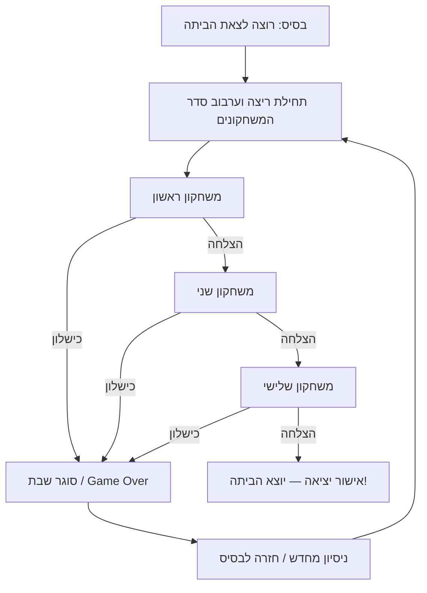

# Ad Matai — תכנון שלבים ומשחקונים (מטלה 3, חלק א׳)

## 1. הקשר למשחק, לקהל היעד ולמבנה השלבים

**Ad Matai** הוא משחק דו־ממדי קומי לשחקן יחיד, בהשראת חוויות האבסורד של השירות הצבאי. השחקן מגלם חייל שרוצה רק דבר אחד: **לצאת מהבסיס הביתה**. בדרך עליו לעבור רצף משימות קצרות, שכל אחת מהן מתורגמת למיני־גיים נפרד. שפת האיור של המשחקונים היא קריקטורית, שטוחה וקריאה, בהשראת הקצב והפשטות של *Dumb Ways to Die* ו-*Rhythm Heaven*, אך בהקשר צבאי ובאופי חזותי עצמאי. גרסת האב־טיפוס מיועדת למחשב ולטלפון, ולכן הממשקים והקלט מתוכננים לשניהם.

**עיקרון התכנון המרכזי:** בניגוד למשחק מסורתי שבו שלב 1 קל, שלב 2 בינוני ושלב 3 קשה, כאן **אין סולם קושי ליניארי בין השלבים**. כל מיני־גיים בוחן מיומנות אחרת: דיוק וזיהוי במטווח, קצב ותזמון בצעידה, וזיכרון סדרתי בתורנות המטבח. האתגר של המשחק השלם אינו להגיע לשלב בעל מספרים גדולים יותר, אלא לפתח **סט מיומנויות רחב**, ללמוד את הכללים של כל משחקון ולהצליח בכולם ברצף. בתוך משחקון בודד אפשר להציג היכרות קצרה ולהגביר מעט לחץ, בלי לשנות את מבנה המשחק למדרגות קושי מסורתיות.

**קהל יעד מתוכנן:** שחקני מחשב ומובייל שאוהבים משחקונים קצרים, מכניקה שקל להבין והומור סיטואציוני; ההקשר הצבאי יעניין במיוחד שחקנים שמכירים את החוויה הישראלית. זהו אפיון איכותני והנחת תכנון, ולא נתון דמוגרפי שנמדד.

**היקף גרסת התכנון:** שלושה משחקונים פעילים — מטווח, צעידה, תורנות מטבח — ושלב רביעי המגדיר את לולאת המשחק המלאה. אפשר להוסיף משחקונים נוספים בהמשך בלי לשנות את עיקרון הלולאה. משכי הזמן והספים המספריים להלן הם **ערכי איזון ראשוניים לבדיקה באבטיפוס**, לא נתונים שכבר נבדקו.

> **הבהרה ביחס להנחיות המטלה:** בדף מטלה 3, חלק א׳, נדרש לתכנן *לפחות ארבע רמות במדרג Tutorial / Easy / Medium / Hard*. המסמך הזה מגדיר בכוונה **ארבע יחידות תכנון מסוג אחר** — שלושה משחקונים ולולאת סיום — ולא ארבע רמות קושי כנדרש מילולית. לכן הוא מציג את חזון המשחק באופן מדויק, אך **אין להניח שהמבנה עומד בדרישה הפורמלית בלי אישור מצוות הקורס**. אם תידרש התאמה, אפשר להוסיף לכל משחקון גרסאות אימון/קל/בינוני/קשה או להסכים עם הצוות על חלוקה חלופית.

---

## 2. כללי תכנון משותפים וערכי איזון

### מבנה ותצוגה

- **פורמט:** כל מיני־גיים מתרחש בזירה דו־ממדית אחת, ללא שיטוט בעולם בזמן המשימה. פריסת המשחק מותאמת למסכי מחשב ולנייד במצב אופקי (Landscape).
- **סביבה:** כל המשחקונים מציגים רקע נפרד, דמות/אובייקטים נפרדים וממשק אחיד של הוראה קצרה, מד זמן/התקדמות ופידבק להצלחה או כישלון.
- **מצבי משחק:** `Intro` (הסבר קצר) → `Playing` → `Won` או `Lost` → מעבר למשחקון הבא / סיום ריצה. אין צורך שמיני־גיים אחד ידע את הלוגיקה של משנהו.
- **תחילת משחקון:** הנחיית שליטה קצרה של כ־2–3 שניות. הריצה המתוזמנת מתחילה רק כשהשחקן יכול לפעול; במובייל ניתן להשתמש בכפתור `Start` כדי להימנע מפספוס בתחילת המשחקון.
- **קלט:** עכבר/מקלדת במחשב; לחיצה ישירה וכפתורי מגע במובייל. יש לספק אזורי לחיצה סלחניים באצבע, גם כאשר הספרייט עצמו קטן יותר.
- **קריאות והוגנות:** שום פריט משחק חיוני לא יוצב מתחת לכפתורי מגע, מתחת לדמות הראשית או מחוץ לשטח בטוח המותאם ליחס המסך. תוצאה של כל פעולה תוצג מיד.
- **כישלון:** כל משחקון מחזיר `Success` או `Failure` למנהל הלולאה; משחקון בודד לא מחליט אם השחקן יצא הביתה.

### מטריצת מיומנויות

| מזהה | משחקון | מיומנות מרכזית | קלט במחשב | קלט בטלפון | יעד זמן |
|---|---|---|---|---|---|
| SR | מטווח | זיהוי, דיוק ומהירות תגובה | עכבר וכוונת | מגע ישיר | 30 שניות |
| MR | צעידה | תזמון לקצב והחלפת צדדים | חצים שמאלה/ימינה | שני כפתורי צד | כ־20 שניות של פעימות |
| KT | תורנות מטבח | זיכרון רצף ודיוק בבחירה | לחיצה על מאכלים | נגיעה במאכלים | כ־30–40 שניות |
| LOOP | יציאה מהבסיס | עקביות ומעבר בין מיומנויות | לפי המשחקון | לפי המשחקון | סכום המשחקונים |

### סימונים לתרשימים

`S` = חייל; `R` = מטרה אדומה; `G` = מגן ירוק; `X` = עמדה שמותר להגריל בה מטרה; `L/R` = צד צעידה או פקד; `F1–F6` = מאכלים; `HUD` = ממשק; `→` = התקדמות או מעבר. התרשימים הם **סקיצות פריסה** ולא קואורדינטות פיקסל. הם מראים אזורים ומיקומים יחסיים; התוכנה תחשב מיקום בפועל לפי גודל המסך.

---

## 3. משחקון ראשון — מטווח (Shooting Range)

**מטרה:** לפגוע במספיק מטרות אדומות בזמן נתון, תוך הימנעות מירי במגנים ירוקים. **מיומנות:** כיוון, החלטה מהירה וסינון גירויים. **משך יעד:** 30 שניות. **ניצחון:** הגעה ל־**20 פגיעות נטו** לפני תום הזמן. **כישלון:** הטיימר מגיע לאפס לפני השגת היעד.

### תרשים — זירת המטווח

```text
+--------------------------------------------------------------+
| HUD: Hits 00/20                              Time: 30s       |
|                                                              |
|              [X1]                 [X2]                       |
|                                                              |
|      [X3]              [X4]                 [X5]             |
|                                                              |
|                [X6]                      [X7]                 |
|                                                              |
| S (שוכב עם נשק)                                שטח פנוי       |
+--------------------------------------------------------------+
```

החייל שוכב בפינה השמאלית התחתונה, ונשקו מופנה למרכז הזירה. כל מטרות המשחק נמצאות **באזור המרכזי והימני בלבד**, כך שהחייל אינו מסתיר אותן. מאחורי עמדות ההופעה יש סוללת עפר ורקע מדברי. הטיימר והניקוד נמצאים בפינות העליונות. `X1–X7` הם **עוגני הופעה אפשריים** בלבד; בכל רגע מאוכלס רק תת־קבוצה מהם.

### סוגי אובייקטים

| מזהה | אובייקט | התנהגות | תגובת השחקן | פידבק |
|---|---|---|---|---|
| R | מטרה אדומה | מופיעה בעמדת הופעה פנויה; נשארת עד שנפגעה | יש לירות | מוחלפת לספרייט מטרה שבורה; `+1` |
| G | מגן ירוק | מופיע כמו מטרה רגילה אך מציין פריט שאסור לפגוע בו | להימנע מירי | הבהוב שגיאה; `−1` לניקוד, מינימום 0 |
| S | חייל שוכב | שני מצבים גרפיים: מנוחה וירי | פועל אוטומטית בעת לחיצה | אפקט לוע קצר, חזרה למצב מנוחה |
| C | כוונת | עיגול לבן עם קו מתאר כהה וארבעה קווים בולטים | עוקבת אחר עכבר במחשב | במובייל מופיעה בנקודת המגע לזמן קצר |

### הפקת גלים ומיקום מטרות

- בכל גל נבחרות **2–3 עמדות שונות** מתוך שבע העמדות, ללא חפיפה.
- בכל גל מופיעה **לפחות מטרה אדומה אחת**. ההתפלגות הראשונית המוצעת: גל של 2 אובייקטים — 1–2 אדומים; גל של 3 אובייקטים — 1–3 אדומים, ולא יותר מ־2 מגנים.
- הגל נחשב גמור כאשר **כל המטרות האדומות נפגעו**; מגנים שלא נורו נעלמים בעצמם. אין צורך לירות במגן כדי לסיים גל.
- גל חדש מתחיל לאחר **0.2 שניות** מרגע סיום הגל הקודם. אם הטיימר הסתיים, לא נוצר גל חדש.
- האלגוריתם מגריל עמדות שאינן תפוסות; שומר מרחק מינימלי מומלץ של כ־**1.5 קוטרי מטרה** בין מרכזי אובייקטים; אין להגריל באזור החייל או באזור ה-HUD.
- מטרות אינן זזות לאחר ההופעה; הקושי נובע מהמיקומים המשתנים, החלטת ירי/אי־ירי ומהזמן הכולל.

### חוקים, קלט וניקוד

| אירוע | התנהגות מדויקת |
|---|---|
| לחיצה במחשב | ירייה במיקום הכוונת; החלפת ספרייט החייל למצב ירי למשך כ־0.12 שניות |
| נגיעה במובייל | ירייה בנקודת המגע; הצגת כוונת למשך כ־0.2 שניות |
| פגיעה ב־R | הסרת המטרה ממשחק פעיל לאחר אפקט שבירה של כ־0.25 שניות; הוספת נקודה אחת |
| פגיעה ב־G | המגן לא נותן ניקוד; הפחתת נקודה אחת, לא מתחת לאפס; סימון ברור של טעות |
| לחיצה על שטח ריק | אפקט ירייה קצר ללא שינוי ניקוד; אפשר להוסיף חיווי פספוס מינימלי |
| הגעה ל־20 נקודות | סיום מיידי בניצחון, גם אם נותר זמן |
| סיום 30 שניות עם פחות מ־20 | כישלון והצגת `Range Failed` |

### קצב, משוב ואיזון

**20 פגיעות ב־30 שניות** משמען קצב ממוצע של פגיעה אחת לכל 1.5 שניות, כולל מעברים בין גלים. זהו יעד ראשוני **מאתגר אך בר־בדיקה**, לא מספר שהוכח כמאוזן. במבחני משחק כדאי להשוות גם יעדים של 16 ו־18 פגיעות ולמדוד הצלחה במחשב ובמובייל. יש לוודא שבטלפון ניתן לפגוע בקלות יחסית: שטח המגע יכול להיות גדול בכ־15–25% מהציור, ללא שינוי חזותי.

**מדוע המשחקון מובחן:** השחקן נדרש לזהות את סוג האובייקט, לבצע החלטת ירי ולכוון במרחב. אין סדר לחיצות קבוע ואין צורך לזכור רצף.

---

## 4. משחקון שני — מסדר צעידה (Marching Drill)

**מטרה:** לשמור על קצב צעידה קבוע באמצעות לחיצות שמאל וימין לסירוגין, בתזמון נכון לפעימות. **מיומנות:** שמיעה/זיהוי פעימה, קצב ותיאום פעולה. **ניצחון:** השלמת **32 פעימות צעידה** עם פחות מ־**3 טעויות**. **כישלון:** טעות שלישית, או אי־עמידה בתנאי השלמת הפעימות.

### תרשים — רחבת המסדר

```text
+--------------------------------------------------------------+
| HUD: Beat 08/32                         Mistakes: X X _       |
|                                                              |
|  מפקד / קריאת "שמאל! ימין!"    חיילי רקע צועדים במקצב       |
|                                                              |
|                        [S]                                   |
|                 רגל שמאל / רגל ימין                           |
|                                                              |
|         [ L ◀ ]                     [ ▶ R ]                  |
|                                                              |
|                  סימון פעימה (Beat Indicator)                 |
+--------------------------------------------------------------+
```

החייל נמצא במרכז הרחבה וצועד **במקום**, כדי לא להזדקק למפה נגללת. ברקע שניים–שלושה חיילים צועדים באופן סינכרוני. המפקד יכול להופיע בצד שמאל ולקרוא את הקצב. תנועת הרגליים, הקריאה הקולית ומד הפעימה נותנים משוב מסונכרן. הכפתורים מוצגים רק בנייד; במחשב ניתן להציג חיצי הדרכה מבלי לחייב לחיצה על ממשק.

### מודל קצב ודיוק

- **BPM התחלתי:** 100 פעימות לדקה, כלומר **0.6 שניות לפעימה**.
- **אורך הרצף:** 32 פעימות = **19.2 שניות** של קצב נטו. נוסף פתיח/ספירה של כ־2–3 שניות וסיום קצר.
- **סדר לחיצות:** `שמאל → ימין → שמאל → ימין` לאורך כל הרצף; הפעימה הראשונה תמיד שמאל.
- **חלון זיהוי:** עד **±0.20 שניות** סביב זמן הפעימה. בתוכו, עד ±0.10 שניות = `Perfect`; השאר = `Good`. מחוץ לחלון = `Miss`.
- **לחיצה על הצד הלא נכון:** `Miss`, גם אם התזמון מדויק.
- **אין לחיצה על הפעימה:** כשהחלון נסגר נרשמת טעות אחת אוטומטית.
- **מניעת ספירת יתר:** לכל פעימה מותרת לחיצה מזכה אחת בלבד. לחיצות חוזרות באותה פעימה לא מזכות בנקודות נוספות; אין להחשיב אותן כטעות נוספת באבטיפוס.
- **אין שינוי BPM באמצע המשחקון** בגרסה הראשונה. היציבות מאפשרת לבחון קצב אמיתי ולא תגובה לשינויי מהירות לא צפויים.

### רצף המשחקון

| מקטע | זמן / פעימות | אירוע | דרישת שחקן |
|---|---|---|---|
| ספירה מקדימה | כ־2.4 שניות (4 פעימות) | המפקד סופר בקול/מוצג סמן קצב | להאזין ולהתכונן, ללא רישום טעויות |
| צעידה | פעימות 1–8 | החייל מתחיל לצעוד; חצים שמאל/ימין מודגשים | ללחוץ על הצד המתאים לפי הפעימה |
| צעידה רציפה | פעימות 9–24 | ממשיכים באותו BPM; פחות עזרה חזותית, אך פעימה נשמעת ונראית | לשמור על הקצב ועל רצף הרגליים |
| סיום מסדר | פעימות 25–32 | המפקד ממשיך לקרוא, מד ההתקדמות מתמלא | לסיים בלי להגיע ל־3 טעויות |

### פקדים ופידבק

| פלטפורמה | פעולה | תוצאה |
|---|---|---|
| מחשב | חץ שמאל / חץ ימין | צעידה ברגל המתאימה בזמן הפעימה |
| טלפון | כפתור שמאל / כפתור ימין גדול בתחתית | אותה בדיקת תזמון בדיוק |
| לחיצה מוצלחת | כל פלטפורמה | אנימציית רגל מתאימה; `Perfect` או `Good` קטן |
| טעות / פספוס | כל פלטפורמה | החייל מגמגם בצעד/מאבד קצב; סימון X אחד |
| ניצחון | כל פלטפורמה | החייל מתייצב לדום והמפקד מאשר המשך |
| כישלון | כל פלטפורמה | החייל דורך על הרגל הלא נכונה/נתקל קלות; המפקד נוזף |

**כלל הוגנות חשוב:** התזמון נמדד לפי **שעון האודיו/הפעימות**, ולא לפי הציור של רגל החייל בלבד. בזמן בדיקות יש להתאים השהיית קלט/סאונד כדי שלא ייווצר פער בין מה שהשחקן שומע לבין החלון שמזכה ב־Perfect או Good. בכישלון מוקדם מפסיקים את הרצף מיד; אין צורך להמתין ל־32 הפעימות.

**מדוע המשחקון מובחן:** השחקן לא מכוון למטרה על המסך ולא זוכר הזמנה; הוא נדרש לשמור פעימה וקואורדינציה לאורך רצף קבוע. בהמשך אפשר להוסיף פקודת "עצור!" כאירוע מיוחד, **אך היא אינה חלק מהאב־טיפוס** כדי לא לסבך את ההטמעה.

---

## 5. משחקון שלישי — תורנות מטבח (Kitchen Duty: Remember the Order)

**מטרה:** לזכור ולהגיש סדר נכון של מאכלים לאחר שהמשחק מדגים את ההזמנה באמצעות רצף הבהובים. **מיומנות:** זיכרון עבודה וזיכרון סדרתי, ולא מהירות ירי או קצב מוזיקלי. **ניצחון:** השלמת **3 הזמנות**. **כישלון:** צבירת **2 טעויות בחירה** לפני השלמת כל ההזמנות, או חריגה ממגבלת זמן התגובה.

### תרשים — פס הגשה

```text
+--------------------------------------------------------------+
| HUD: Orders 0/3                           Errors 0/2         |
|                                                              |
| חייל ממתין + מגש ריק          הוראה: "זכור את סדר ההגשה"    |
|                                                              |
|          [ F1 ]       [ F2 ]       [ F3 ]                    |
|          שניצל        אורז         סלט                       |
|                                                              |
|          [ F4 ]       [ F5 ]       [ F6 ]                    |
|          פסטה         פירה         חמוצים                    |
|                                                              |
|       רצף נדלק → ההדגמה מסתיימת → השחקן משחזר               |
+--------------------------------------------------------------+
```

ששת המאכלים נמצאים ב**שתי שורות קבועות של שלושה פריטים**. כל פריט הוא כפתור גדול עם ספרייט ברור ושם קצר, ובזמן ההדגמה הוא מואר/קופץ מעט. הזמנה מוצלחת מעבירה מגש לחייל, ובמקומו מגיע חייל אחר. לא נדרשות גרירה, פיזיקת אוכל או בניית מנות מפורטת בסגנון משחק מסעדה.

### מאגר הפריטים

| מזהה | מאכל | מיקום | אות משוב |
|---|---|---|---|
| F1 | שניצל | שורה 1, טור 1 | הבהוב/קפיצה קצרה |
| F2 | אורז | שורה 1, טור 2 | הבהוב/קפיצה קצרה |
| F3 | סלט | שורה 1, טור 3 | הבהוב/קפיצה קצרה |
| F4 | פסטה | שורה 2, טור 1 | הבהוב/קפיצה קצרה |
| F5 | פירה | שורה 2, טור 2 | הבהוב/קפיצה קצרה |
| F6 | חמוצים | שורה 2, טור 3 | הבהוב/קפיצה קצרה |

### רצף ההזמנות וערכי זמן מוצעים

| הזמנה | אורך רצף | דוגמה לרצף | הצגת כל פריט | זמן תגובה מרבי לאחר ההדגמה |
|---|---:|---|---|---:|
| 1 | 2 | F2 → F1 | 0.7 ש׳ מואר + 0.2 ש׳ הפסקה | 6 ש׳ |
| 2 | 3 | F3 → F5 → F1 | 0.7 ש׳ מואר + 0.2 ש׳ הפסקה | 8 ש׳ |
| 3 | 4 | F6 → F2 → F4 → F1 | 0.7 ש׳ מואר + 0.2 ש׳ הפסקה | 10 ש׳ |

**בחירת רצפים:** הטבלה מדגימה רצפים תקינים. בכל ריצה אפשר להגריל רצף מתוך ששת הפריטים, אך **ללא חזרות בתוך אותה הזמנה** בגרסת האב־טיפוס, כדי לצמצם עומס זיכרון ולהקל על הקריאות. ערכי הצגת הפריטים קבועים; רק אורך הרצף גדל מעט בין הזמנות, כהיכרות עם מכניקת המשחקון ולא כסולם קושי בין המשחקונים.

### כללי שליטה, טעויות והתקדמות

1. בראש כל הזמנה מופיעה הודעת `Watch the order`. לאורך ההדגמה **הקלט על המאכלים חסום**.
2. כל פריט ברצף מואר בתורו למשך 0.7 שניות, עם הפסקה של 0.2 שניות; בסיום מופיעה הודעת `Your turn`.
3. השחקן לוחץ על המאכלים **באותו סדר** שבו נדלקו. לחיצה נכונה מקדמת את מונה המקום ברצף ומפעילה פידבק חיובי קצר.
4. **לחיצה לא נכונה:** מתווספת טעות אחת, ההזמנה הנוכחית מתאפסת ונראית שוב **אותה הזמנה** (אין צורך ליצור רצף חדש). אם זו הטעות השנייה — המשחקון נכשל מיד.
5. **חלון הזמן:** לכל הזמנה יש זמן תגובה נפרד שמתחיל *אחרי* הצגת הרצף. אם הזמן נגמר — נרשמת טעות אחת וההזמנה מוצגת מחדש באותם תנאים.
6. השלמת כל הפריטים בהזמנה מעניקה הזמנה מוצלחת אחת. אחרי מעבר קצר של כ־0.5 שניות מתחילה ההזמנה הבאה.
7. לאחר שלוש הזמנות מוצלחות מתקבל ניצחון; אם מספר הטעויות מגיע ל־2 לפני כן מתקבל כישלון.

### חישוב משך המשחקון

הדגמת הרצפים אורכת בקירוב 1.8 + 2.7 + 3.6 = **8.1 שניות**; חלונות התגובה המקסימליים הם 6 + 8 + 10 = **24 שניות**; נוסף מעבר של כשנייה בין הזמנות ופתיח קצר. לכן משך סביר ללא טעות הוא **כ־15–35 שניות**, בהתאם למהירות השחקן. בניגוד למטווח, כאן **אין טיימר כולל של 30 שניות**: הזמן מוגבל לכל הזמנה, כדי שלא להעניש את השחקן על זמן ההדגמה שאינו בשליטתו.

### חוויית משחק ויישום

- **מחשב:** לוחצים עם העכבר על המאכלים. **מובייל:** נוגעים בפריט; אין צורך בהטיית מכשיר, גרירה או מקלדת.
- **פידבק חזותי:** הפריט הנוכחי מואר; פריט שנבחר נכון מקבל סימון קצר; טעות מלווה בצליל שגוי והבעת פנים מתוסכלת של החייל בתור.
- **הומור:** כל הזמנה היא חלק מתורנות מטבח צבאית לא נגמרת; בסיום מוצלח מוצג חייל מרוצה, ובכישלון אפשר להציג תגובה כמו "מי ביקש את זה?!".
- **היקף מימוש:** שש תמונות מאכלים, מגש, חיווי אור, שלושה רצפים ומערכת בדיקת קלט. אין צורך בסימולציית בישול או כלים נגררים.

**מדוע המשחקון מובחן:** השחקן רואה מידע לזמן קצר, מחזיק אותו בזיכרון ומשחזר **סדר**. הכפתורים אמנם לחיצים כמו מטרות במטווח, אבל אין כאן כיוון מהיר במרחב אלא מבחן זיכרון רצף, ולכן תחושת המשחק שונה.

---

## 6. שלב מסכם — לולאת המשחק: לצאת מהבסיס (The Way Home)

**מטרה:** להשלים ברצף את כל המיני־גיימס הכלולים בריצה, כדי לקבל אישור לצאת הביתה. **מיומנות:** מעבר בין מיומנויות נפרדות, ריכוז ועקביות לאורך ריצה שלמה. **ניצחון:** כל המשחקונים בריצה הושלמו בהצלחה. **כישלון:** כישלון באחד מהם מסיים את הריצה ומונע יציאה הביתה.

### תרשים זרימה של הריצה



**פירוש החצים:** חץ המסומן **הצלחה** מוביל למשחקון הבא (או ליציאה הביתה לאחר האחרון); חץ המסומן **כישלון** מוביל **אך ורק** למסך `סוגר שבת / Game Over`. גם אם סדר המשחקונים משתנה בכל ריצה, חוק המעבר אינו משתנה.

### כללי הריצה

- **מאגר משחקונים בגרסה הנוכחית:** `SR`, `MR`, `KT`.
- **בחירת סדר:** בתחילת כל ריצה מתבצע ערבוב אקראי של שלושת המזהים (`Shuffle`). **כל משחקון מופיע בדיוק פעם אחת**, כך שלא תיתכן חזרה על משחקון זהה לפני ששלושתם הושלמו.
- **שקיפות:** לפני כל משחקון מוצגת הודעה קצרה עם שם המשימה והוראת שליטה. אפשר להראות `Task 2/3` כדי שהשחקן ידע כמה נשארו לו, בלי לחשוף מראש את סדר המשחקונים.
- **הצלחה במשחקון:** המנהל מסמן אותו כ־`Completed`, משמר את תוצאתו, ממתין כ־1 שנייה ועובר לבא בתור.
- **כישלון במשחקון:** הריצה נעצרת מיד. מסך `סוגר שבת` מציג את שם המשחקון שבו נכשל ואת מספר המשחקונים שהצליח להשלים.
- **Retry:** מתחיל **ריצה חדשה מההתחלה**, עם סדר חדש; לא חוזרים רק למשחקון שנכשל. זהו לב המתח וההומור שבניסיון להשיג יציאה הביתה.
- **ניצחון כולל:** לאחר השלמת כל המשחקונים מופיע מסך `יצאת הביתה!` עם תגובת החייל ואפשרות לריצה נוספת.
- **אורך ריצה:** כ־1.5–2 דקות לא כולל הסברים ומעברים, אם שלוש המשימות מושלמות בניסיון הראשון. זהו סדר גודל לאב־טיפוס, לא הבטחה למשך משחק מדויק.

### תכנון נתונים מינימלי למנהל המשחק

| שדה | תפקיד | דוגמה |
|---|---|---|
| `availableMinigames` | רשימת משחקונים שמותקנים במשחק | `[SR, MR, KT]` |
| `runOrder` | רשימה מעורבבת של משחקונים ללא כפילויות | `[KT, SR, MR]` |
| `currentIndex` | אינדקס המשימה הנוכחית | `1` |
| `completedCount` | כמה משימות הושלמו בהצלחה | `1` |
| `runState` | מצב הריצה | `Playing / Won / Lost` |
| `lastResult` | תוצאה שמחזיר המשחקון | `Success / Failure` |

### הרחבת המשחק בהמשך

המערכת **אינה מוגבלת לשלושה משחקונים**. אפשר בהמשך להוסיף ניקוי נשק, שמירה לילית עם איזון כיסא, ניקוי בסיס, תורנות נוספת או משימות אחרות. כל משחקון חדש יירשם במאגר עם מזהה, סצנה, הנחיית שליטה ותנאי הצלחה/כישלון, ויחזיר את אותה תוצאה למנהל הריצה. בגרסה מורחבת אפשר להגדיר שהריצה כוללת את **כל** המשחקונים הזמינים, או מספר קבוע שנבחר באקראי; **בגרסת האב־טיפוס הנוכחית יש להשלים את כולם**, כלומר את שלושתם.

**Hub צבאי:** בתכנון ארוך הטווח, בסיס קטן במבט עילי יכול לאפשר שיטוט, תרגול בעמדות שונות ושדרוגים/קוסמטיקה. עם זאת, הוא **אינו תנאי להדגמת לולאת המשחק הראשונית**: אפשר להתחיל במסך בסיס סטטי עם כפתור `נסה לצאת הביתה`, כדי לבחון קודם את הרצף, המעברים ותחושת ההצלחה/הכישלון.

**מדוע זהו השלב המסכם:** הוא לא מעלה את מהירות המטרות, BPM או אורך הזיכרון, אלא דורש מהשחקן **להפגין שליטה בכל שלוש המיומנויות באותה ריצה**. האתגר נוצר משילוב של משימות שונות ומהמחיר של כישלון מאוחר בריצה.

---

## 7. השוואה בין שלושת המשחקונים ובין הלולאה

| קריטריון | מטווח | צעידה | מטבח | לולאת יציאה |
|---|---|---|---|---|
| מיומנות | כיוון וזיהוי | תזמון וקצב | זיכרון סדרתי | עקביות ורב־מיומנות |
| יחידת התקדמות | פגיעה במטרה אדומה | פעימה נכונה | הזמנה שהושלמה | משחקון שהושלם |
| יעד מוצע | 20 נקודות | 32 פעימות, פחות מ־3 טעויות | 3 הזמנות, פחות מ־2 טעויות | 3/3 משחקונים |
| זמן | 30 שניות | כ־20 שניות נטו | 15–35 שניות לרוב | סכום המשחקונים והמעברים |
| כישלון | זמן הסתיים | 3 טעויות | 2 טעויות | כל משחקון שנכשל |
| מה השחקן לומד | לבחור במה לירות ולכוון | לשמור על פעימות | לזכור סדר לאחר הדגמה | לעבור במהירות בין חוקים שונים |
| קלט במובייל | נגיעה במטרות | שני כפתורי צד | בחירת פריט | בהתאם למשחקון |

**איזון בין המשחקונים:** אין סיבה לדרוש מכל משחקון אותו מספר פעולות או אותה שנייה בדיוק. במקום זאת, יש לבדוק שמי שמבין את הכללים ומבצע באופן סביר יכול לנצח בכל אחד מהם, ושאף משחקון אינו הופך למחסום חריג. קושי יחסי יימדד בניסויי משתמשים באמצעות שיעור הצלחה בכל משחקון, מספר טעויות וזמן השלמה.

---

## 8. התאמה למטלה, סדר פיתוח והיקף מעשי

המסמך נכתב כ**חלק א׳ — תכנון**, בדומה למסמך ה-Level Design של הפרויקט האחר: הוא כולל מטרה, קלט, תנאי מעבר, ערכי איזון, התנהגות אובייקטים, תרשימי פריסה, הסבר על המיומנות הנבדקת והיקף מימוש משוער. מימוש Prefabs, Spawn, התנגשויות, מנהל רמות, התאמה למובייל ובנייה ל-WebGL/Android שייכים ל**חלק ב׳** של המטלה ולא מהווים התחייבות שנעשו בפועל.

**סדר פיתוח מומלץ:** (1) מטווח — רלוונטי לנכסים הגרפיים שכבר הוכנו, ובוחן יצירת מטרות וקלט; (2) צעידה — דורש מערכת פעימות ותזמון; (3) מטבח — דורש רצפים, הבהובים ושחזור סדר; (4) מנהל לולאה — מחבר בין התוצאות ומציג יציאה הביתה או סגירת שבת.

**בדיקות נחוצות:** (א) יחס מסך 16:9 ו־20:9, (ב) כפתורים ונגיעות בטלפון בלי חפיפות, (ג) רגישות נקודות לחיצה במטווח, (ד) סנכרון קול/פעימות בצעידה, (ה) זמן הצגה וזיכרון במטבח, (ו) מעבר נכון בין שלוש סצנות ללא הישנות או דילוג במשחקון, (ז) כישלון מאוחר שמחזיר לתחילת הריצה.

**הערה להגשה:** מבנה זה משקף במדויק את הרעיון של משחקונים בעלי מיומנויות שונות, **אבל אינו מספק כשלעצמו את ארבע דרגות הקושי שנדרשו בנוסח המטלה**. יש לקבל אישור מפורש מצוות הקורס לחלוקה החלופית או להוסיף נספח עם ארבע גרסאות קושי לכל משחקון לפני הגשה.

## 9. מקורות והנחות תכנון

- [GitHub — Ad Matai](https://github.com/CS-Ariel-GameDev-Project/Ad-Matai) — מאגר הפרויקט, לצורך קישור להגשה. המסמך נשען על אפיון המשחקונים והלופ שנדונו, ולא על בדיקה מאומתת של קבצים עדכניים במאגר.
- `Level_Design(1).md` — מסמך הדוגמה שסופק עבור *Frieren: Demon Hunt*, המשמש מודל לרמת הפירוט, לכותרות, לטבלאות ולתרשימי השלבים.
- `homework (1).pdf` — מטלה 3 של הקורס, חלק א׳ (תכנון רמות) וחלק ב׳ (מימוש ראשוני).
- **ערכי תכנון מוצעים:** זמני הבהוב/מעבר, מספר הפעימות, חלונות התזמון, אורך רצפים וספי הטעויות הם הצעות הנדסיות לאבטיפוס; יש לבחון ולאזן אותם לאחר מימוש.
