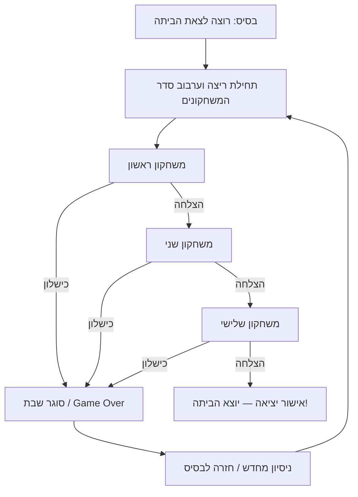

# Ad Matai — תכנון שלבים ומשחקונים (מטלה 3, חלק א׳)

## 1. הקשר למשחק, לקהל היעד ולמבנה השלבים

**Ad Matai** הוא משחק דו־ממדי קומי לשחקן יחיד, בהשראת חוויות האבסורד של השירות הצבאי. השחקן מגלם חייל שרוצה רק דבר אחד: **לצאת מהבסיס הביתה**. בדרך עליו לעבור רצף משימות קצרות, שכל אחת מהן מתורגמת למיני־גיים נפרד. שפת האיור של המשחקונים היא קריקטורית, שטוחה וקריאה, בהשראת הקצב והפשטות של *Dumb Ways to Die* ו-*Rhythm Heaven*, אך בהקשר צבאי ובאופי חזותי עצמאי. גרסת האב־טיפוס מיועדת למחשב ולטלפון, ולכן הממשקים והקלט מתוכננים לשניהם.

**עיקרון התכנון המרכזי:** במשחק המלא **אין סולם קושי ליניארי בין סוגי המשימות**: כל מיני־גיים בוחן מיומנות אחרת — דיוק וזיהוי במטווח, קצב ותזמון בצעידה, וזיכרון סדרתי בתורנות המטבח. האתגר הוא לפתח **סט מיומנויות רחב** ולהצליח בכולן ברצף. יחד עם זאת, לכל משחקון ניתן להגדיר רמות קושי *בתוך אותה מכניקה*. במסמך זה המטווח מפורט בארבע רמות מובחנות (Tutorial, Easy, Medium, Hard), ואילו בצעידה ובמטבח מוצגים ערכי בסיס ופרמטרים להרחבה עתידית.

**קהל יעד מתוכנן:** שחקני מחשב ומובייל שאוהבים משחקונים קצרים, מכניקה שקל להבין והומור סיטואציוני; ההקשר הצבאי יעניין במיוחד שחקנים שמכירים את החוויה הישראלית. זהו אפיון איכותני והנחת תכנון, ולא נתון דמוגרפי שנמדד.

**היקף גרסת התכנון:** שלושה משחקונים — מטווח, צעידה ותורנות מטבח — ושלב מסכם המגדיר את לולאת המשחק המלאה. המטווח כולל **ארבע רמות מפורטות**; בריצה הרגילה של המשחק השלם משתמשים בקושי נבחר של המטווח (ברירת מחדל מוצעת: בינוני), **לא מבצעים את כל ארבע רמות המטווח ברצף**. אפשר להוסיף משחקונים נוספים בהמשך בלי לשנות את עיקרון הלולאה. המספרים הם **ערכי איזון ראשוניים לבדיקה**, ולא תוצאות של מבחני משתמשים.


---

## 2. כללי תכנון משותפים וערכי איזון

### מבנה ותצוגה

- **פורמט:** כל מיני־גיים מתרחש בזירה דו־ממדית אחת, ללא שיטוט בעולם בזמן המשימה. פריסת המשחק מותאמת למסכי מחשב ולנייד במצב אופקי (Landscape).
- **סביבה:** כל המשחקונים מציגים רקע נפרד, דמות/אובייקטים נפרדים וממשק אחיד של הוראה קצרה, מד זמן/התקדמות ופידבק להצלחה או כישלון.
- **מצבי משחק:** `Intro` (הסבר קצר) → `Playing` → `Won` או `Lost` → מעבר למשחקון הבא / סיום ריצה. אין צורך שמיני־גיים אחד ידע את הלוגיקה של משנהו.
- **תחילת משחקון:** הנחיית שליטה קצרה של כ־2–3 שניות. הריצה המתוזמנת מתחילה רק כשהשחקן יכול לפעול; במובייל ניתן להשתמש בכפתור `Start` כדי להימנע מפספוס בתחילת המשחקון.
- **קלט:** עכבר/מקלדת במחשב; לחיצה ישירה וכפתורי מגע במובייל. יש לספק אזורי לחיצה סלחניים באצבע, גם כאשר הספרייט עצמו קטן יותר.
- **קריאות והוגנות:** שום פריט משחק חיוני לא יוצב מתחת לכפתורי מגע, מתחת לדמות הראשית או מחוץ לשטח בטוח המותאם ליחס המסך. תוצאה של כל פעולה תוצג מיד.
- **כישלון:** כל משחקון מחזיר `Success` או `Failure` למנהל הלולאה; משחקון בודד לא מחליט אם השחקן יצא הביתה.

### מטריצת מיומנויות

| מזהה | משחקון | מיומנות מרכזית | קלט במחשב | קלט בטלפון | יעד זמן |
|---|---|---|---|---|---|
| SR | מטווח — מדריך + קל/בינוני/קשה | זיהוי, דיוק ומהירות תגובה | עכבר וכוונת | מגע ישיר | מדריך ללא שעון; 30 שניות בכל רמת קושי |
| MR | צעידה | תזמון לקצב והחלפת צדדים | חצים שמאלה/ימינה | שני כפתורי צד | כ־20 שניות של פעימות |
| KT | תורנות מטבח | זיכרון רצף ודיוק בבחירה | לחיצה על מאכלים | נגיעה במאכלים | כ־30–40 שניות |
| LOOP | יציאה מהבסיס | עקביות ומעבר בין מיומנויות | לפי המשחקון | לפי המשחקון | סכום המשחקונים |

### סימונים לתרשימים

`S` = חייל; `R` = מטרה אדומה; `G` = מגן ירוק; `X` = עמדה שמותר להגריל בה מטרה; `L/R` = צד צעידה או פקד; `F1–F6` = מאכלים; `HUD` = ממשק; `→` = התקדמות או מעבר. התרשימים הם **סקיצות פריסה** ולא קואורדינטות פיקסל. הם מראים אזורים ומיקומים יחסיים; התוכנה תחשב מיקום בפועל לפי גודל המסך.

---

## 3. משחקון ראשון — מטווח (Shooting Range)

**מטרת המשחקון:** לפגוע במטרות האדומות תוך הימנעות מירי במגנים הירוקים, כדי להשיג יעד פגיעות במסגרת הזמן. **מיומנות:** זיהוי מהיר, דיוק, בחירת פעולה ומהירות תגובה. המשחקון כולל **מדריך ושלוש רמות קושי נפרדות**, המבוססות על אותה זירה ועל אותה מערכת גלים. אין צורך לפתח ארבע סצנות נפרדות: ניתן להגדיר ארבע תצורות נתונים לאותו משחקון.

### 3.1 מבנה הזירה ותרשים משותף

```text
+----------------------------------------------------------------+
| HUD: Hits 00/XX                                     Time: 30s  |
|                                                                |
|              [X1]                     [X2]                     |
|                                                                |
|       [X3]            [X4]                    [X5]              |
|                                                                |
|                 [X6]                       [X7]                 |
|                                                                |
| S — חייל שוכב (פינה שמאלית תחתונה)       אזור מטרות בטוח      |
+----------------------------------------------------------------+
```

`S` הוא החייל עם הרובה, קבוע בפינה השמאלית התחתונה; `X1–X7` הן **שבע עמדות הופעה אפשריות** בשטח המרכזי והימני. העמדות מייצגות מיקומים יחסיים בטוחים, שאינם מוסתרים בידי החייל ואינם חופפים ל-HUD. בזמן משחק נבחרת תת־קבוצה של עמדות בהתאם לגודל הגל. הרקע הוא מטווח מדברי עם סוללת עפר, ללא מטרות כחלק מתמונת הרקע עצמה.

### 3.2 אובייקטים ופעולות משותפות

| מזהה | אובייקט | הופעה והתנהגות | תגובה |
|---|---|---|---|
| `R` | מטרה אדומה עגולה | מופיעה באחת מעמדות הגל ונשארת עד לפגיעה | לחיצה עליה: אפקט שבירה, צליל פגיעה, `+1` |
| `G` | מגן ירוק | מופיע באותה מערכת עמדות; אסור לירות בו | לחיצה עליו: אפקט שבירה/שגיאה, `−1` מהניקוד (מינימום 0) |
| `S` | חייל | ספרייט במצב מנוחה, ומצב ירי קצר | בכל לחיצה מוצג ספרייט הירייה למשך כ־0.12 שניות ומושמע צליל ירייה |
| `C` | כוונת | עיגול לבן קטן, מסגרת שחורה וארבעה קווים בולטים | במחשב עוקבת אחרי העכבר; בטלפון מופיעה בנקודת הנגיעה לכ־0.2 שניות |

**חוקים קבועים בכל הרמות המתוזמנות:**

- שעון הפעולה הוא **30 שניות** מרגע האות להתחלה, ואינו מתאפס בין גלים.
- מטרות מופיעות בקבוצות (`Waves`) במיקומים אקראיים מתוך שבע עמדות בטוחות. מיקומים שונים נבחרים באותו גל, ולכן אין חפיפה בין מטרות.
- בכל גל חייבת להיות **לפחות מטרה אדומה אחת**. מגן ירוק הוא גורם מסיח, לא יעד שחייבים לפגוע בו.
- הגל מסתיים **רק כאשר כל המטרות האדומות שבו נפגעו**; המגנים ששרדו נעלמים ללא קנס. הגל הבא נוצר לאחר כ־**0.2 שניות**.
- פגיעה במטרה אדומה מוסיפה נקודה אחת; פגיעה במגן מפחיתה נקודה אחת, עד מינימום אפס. ירי בשטח ריק אינו משנה ניקוד, אך מפעיל אנימציית ירייה.
- בהגעה ליעד הפגיעות הרמה מסתיימת **מיד בהצלחה**; אם השעון מגיע לאפס לפני היעד, מתקבל כישלון.
- המטרות **אינן נעות לאחר הופעתן** ואין להן טיימר היעלמות עצמאי. השינוי בקושי מתבסס על כמות האובייקטים בגל, היחס בין אדומים לירוקים ומספר הפגיעות הנדרש בזמן קבוע.
- כדי לשמור על הוגנות במובייל, אזור הלחיצה של כל מטרה יכול להיות גדול בכ־15–25% מהספרייט המוצג, בתנאי שאזורי לחיצה אינם חופפים.

### 3.3 רמת מדריך — Tutorial: First Shots

**מטרה:** ללמד במפורש על מה **כן** לוחצים ועל מה **לא** לוחצים, בלי לחץ זמן ובלי כישלון סופי. **משך יעד:** כ־15–25 שניות, תלוי בקצב הלמידה. **ניצחון:** השלמת שלושת צעדי ההדרכה (ארבע פגיעות אדומות בסך הכול) והדגמת הבנת תפקיד המגן. **כישלון:** אין; טעויות מוסברות ומאפשרות ניסיון חוזר.

#### תרשים — שלוש עמדות הדרכה

```text
+----------------------------------------------------------+
|   TUTORIAL: פגע באדום, אל תירה בירוק                     |
|                                                          |
|          [R]                       [G]                    |
|      "לירות כאן"                "לא לירות"               |
|                                                          |
| S                                                        |
|                    [הבא / המשך]                         |
+----------------------------------------------------------+
```

#### רצף ההדרכה

| צעד | מה מופיע | הנחיה מדויקת | התנאי להתקדמות |
|---|---|---|---|
| 1 — היכרות עם ירי | מטרה אדומה אחת בעמדה X4 | `לחץ על המטרה האדומה כדי לירות`; חץ/הילה מצביעים עליה | פגיעה באדומה אחת |
| 2 — זיהוי פריט אסור | מגן ירוק אחד בעמדה X5, לצד מטרה אדומה ב-X2 | `באדום יורים; בירוק אסור לירות` | פגיעה באדומה ללא דרישה ללחוץ על הירוק |
| 3 — תרגול קצר | אדומה ב-X3 ואדומה ב-X6, מגן ב-X4 | `פגע בשתי המטרות האדומות והימנע מהמגן` | פגיעה בשתי האדומות; לאחר מכן מתקבלת הודעת הצלחה |

**התנהגות בטעות:** לחיצה במגן תפעיל צליל שגיאה והודעה קצרה `זה מגן — לא יורים בו!`; הניקוד והמטרה של המדריך אינם נענשים, והצעד נמשך. אין טיימר במדריך ואין מעבר לשלב הבא עד שהתנאי הושלם. במחשב תוצג הכוונת ובטלפון יוצג הסבר `גע במטרה כדי לירות`.

**מדוע זו רמת מדריך:** היא מבודדת את פעולת הלחיצה ואת ההבחנה בין שני סוגי המטרות, לפני שילוב מהירות, גלים וניקוד.

### 3.4 רמה קלה — Easy: Basic Range

**מטרה:** להצליח לזהות ולירות במטרות מעטות בקצב מתון. **משך:** 30 שניות. **ניצחון:** **12 נקודות נטו**. **כישלון:** השעון מסתיים לפני 12.

- **2 אובייקטים בכל גל**, בעמדות אקראיות שונות.
- **הרכב הגל:** 70% מהגלים כוללים `2R`; 30% כוללים `1R + 1G`.
- **לכל היותר מגן אחד בגל**, ולעיתים אין מגן כלל.
- **השהיה בין גלים:** 0.2 שניות לאחר פגיעה בכל האדומות.
- **יעד קצב:** 12 נקודות ב־30 שניות = פגיעה נטו אחת בכל **2.5 שניות** בממוצע.

#### דוגמאות להרכב גלים

| דוגמת גל | הרכב | עמדות אפשריות לדוגמה | מה נדרש |
|---|---|---|---|
| 1 | `2R` | X2, X4 | לירות בשתי המטרות |
| 2 | `1R + 1G` | X5 אדומה, X3 מגן | לפגוע רק באדומה |
| 3 | `2R` | X1, X7 | לירות בשתי האדומות |

הטבלה היא **דוגמה בלבד**; הרכב הגל מוגרל לפי ההסתברויות לעיל, והעמדות נבחרות באקראי מתוך השבע. רמה זו מאפשרת להתרגל למעבר בין גלים בלי עומס חזותי גבוה.

### 3.5 רמה בינונית — Medium: Mixed Targets

**מטרה:** להגביר את קצב הירי ואת הצורך לסנן מטרות מטעות. **משך:** 30 שניות. **ניצחון:** **16 נקודות נטו**. **כישלון:** השעון מסתיים לפני 16.

- **2–3 אובייקטים בגל**: 40% מהגלים עם 2, ו־60% עם 3.
- **הרכב הגל:** בגל של 2 אובייקטים `2R` או `1R + 1G` בהסתברות שווה; בגל של 3 אובייקטים `2R + 1G` (70%) או `3R` (30%).
- **לכל היותר מגן אחד בגל**, אך השחקן פוגש אותו בתדירות גבוהה יותר מבקל.
- **השהיה בין גלים:** 0.2 שניות.
- **יעד קצב:** 16 נקודות ב־30 שניות = פגיעה נטו אחת בכל **1.875 שניות** בממוצע.

#### דוגמאות להרכב גלים

| דוגמת גל | הרכב | עמדות אפשריות לדוגמה | מה נדרש |
|---|---|---|---|
| 1 | `2R + 1G` | X2 ו-X4 אדומות, X6 מגן | שתי פגיעות ללא פגיעה במגן |
| 2 | `1R + 1G` | X3 אדומה, X5 מגן | סינון מהיר |
| 3 | `3R` | X1, X4, X7 | שלוש פגיעות מהירות |

רמה זו מוסיפה **יותר מטרות בו־זמנית ויותר החלטות**, בלי להוסיף סוגי אובייקטים חדשים או לשנות את כללי המשחק.

### 3.6 רמה קשה — Hard: Final Qualification

**מטרה:** לעמוד בקצב גבוה תחת עומס הסחות. **משך:** 30 שניות. **ניצחון:** **20 נקודות נטו**. **כישלון:** השעון מסתיים לפני 20.

- **3 אובייקטים בכל גל**, בשלוש עמדות אקראיות שונות.
- **הרכב הגל:** `2R + 1G` ב־60% מהגלים; `3R` ב־20%; `1R + 2G` ב־20%.
- **עד שני מגנים בגל**, כך שלפעמים רק אובייקט אחד מתוך שלושה הוא יעד תקין.
- **השהיה בין גלים:** 0.2 שניות.
- **יעד קצב:** 20 נקודות ב־30 שניות = פגיעה נטו אחת בכל **1.5 שניות** בממוצע.

#### דוגמאות להרכב גלים

| דוגמת גל | הרכב | עמדות אפשריות לדוגמה | מה נדרש |
|---|---|---|---|
| 1 | `2R + 1G` | X1 ו-X5 אדומות, X3 מגן | לירות בשתי האדומות |
| 2 | `1R + 2G` | X6 אדומה, X2 ו-X4 מגנים | לזהות מטרה יחידה נכונה |
| 3 | `3R` | X1, X4, X7 | רצף של שלוש פגיעות |

**הוגנות:** גם בקשה אין תזוזת מטרות, אין שינוי פתאומי של סוג מטרה אחרי הופעה ואין הופעה באזור החייל. היעד הגבוה, מספר האובייקטים והיחס בין אדום לירוק הם מקור הקושי, ולא אירועים שאי אפשר לצפות או להבין.

### 3.7 השוואה מפורשת בין ארבע רמות המטווח

| פרמטר | Tutorial | Easy | Medium | Hard |
|---|---|---|---|---|
| זמן | ללא מגבלה | 30 שניות | 30 שניות | 30 שניות |
| יעד | השלמת צעדי ההדרכה | 12 נקודות נטו | 16 נקודות נטו | 20 נקודות נטו |
| מספר אובייקטים בגל | 1–3, קבוע לפי ההדרכה | 2 | 2–3 | 3 |
| מגנים בגל | 0–1 | 0–1 | 0–1 | 0–2 |
| מיקומים | מודרכים וקבועים | אקראיים | אקראיים | אקראיים |
| קנס על פגיעה במגן | הסבר בלבד | −1 | −1 | −1 |
| מה נלמד / נבחן | על מה לוחצים וממה נמנעים | יסודות הכיוון | קצב וסינון | דיוק תחת עומס |

**יישום ואיזון:** כל הרמות יכולות להשתמש באותו `TargetSpawner`, באותן שבע עמדות, באותם Prefabs ובאותו מנגנון ניקוד. ההבדל הוא במערך הגדרות כגון `requiredHits`, `duration`, `minWaveSize`, `maxWaveSize` ו־`waveCompositionWeights`. בהגדרות אלה המספרים הם **נקודת התחלה לתכנון**, ולא ערכי קושי שנבדקו בפועל. אחרי מימוש מומלץ להריץ מבחני משחק גם במחשב וגם בטלפון, ובמידת הצורך לשנות יעד פגיעות או יחסי הופעה בלי לשנות את המכניקה.

---

## 4. משחקון שני — מסדר צעידה (Marching Drill)

**מטרה:** לשמור על קצב צעידה קבוע באמצעות לחיצות שמאל וימין לסירוגין, בתזמון נכון לפעימות. **מיומנות:** שמיעה/זיהוי פעימה, קצב ותיאום פעולה. **ניצחון:** השלמת **32 פעימות צעידה** עם פחות מ־**3 טעויות**. **כישלון:** טעות שלישית (לרבות פעימה שהוחמצה).

### תרשים — רחבת המסדר

```text
+--------------------------------------------------------------+
| HUD: Beat 08/32                         Mistakes: X X _       |
|                                                              |
|  מפקד / קריאת "שמאל! ימין!"    חיילי רקע צועדים במקצב       |
|                                                              |
|                        [S]                                   |
|                 רגל שמאל / רגל ימין                           |
|                                                              |
|         [ L ◀ ]                     [ ▶ R ]                  |
|                                                              |
|                  סימון פעימה (Beat Indicator)                 |
+--------------------------------------------------------------+
```

החייל נמצא במרכז הרחבה וצועד **במקום**, כדי לא להזדקק למפה נגללת. ברקע שניים–שלושה חיילים צועדים באופן סינכרוני. המפקד יכול להופיע בצד שמאל ולקרוא את הקצב. תנועת הרגליים, הקריאה הקולית ומד הפעימה נותנים משוב מסונכרן. הכפתורים מוצגים רק בנייד; במחשב ניתן להציג חיצי הדרכה מבלי לחייב לחיצה על ממשק.

### מודל קצב ודיוק

- **BPM התחלתי:** 100 פעימות לדקה, כלומר **0.6 שניות לפעימה**.
- **אורך הרצף:** 32 פעימות = **19.2 שניות** של קצב נטו. נוסף פתיח/ספירה של כ־2–3 שניות וסיום קצר.
- **סדר לחיצות:** `שמאל → ימין → שמאל → ימין` לאורך כל הרצף; הפעימה הראשונה תמיד שמאל.
- **חלון זיהוי:** עד **±0.20 שניות** סביב זמן הפעימה. בתוכו, עד ±0.10 שניות = `Perfect`; השאר = `Good`. מחוץ לחלון = `Miss`.
- **לחיצה על הצד הלא נכון:** `Miss`, גם אם התזמון מדויק.
- **אין לחיצה על הפעימה:** כשהחלון נסגר נרשמת טעות אחת אוטומטית.
- **מניעת ספירת יתר:** לכל פעימה מותרת לחיצה מזכה אחת בלבד. לחיצות חוזרות באותה פעימה לא מזכות בנקודות נוספות; אין להחשיב אותן כטעות נוספת באבטיפוס.
- **אין שינוי BPM באמצע המשחקון** בגרסה הראשונה. היציבות מאפשרת לבחון קצב אמיתי ולא תגובה לשינויי מהירות לא צפויים.

### רצף המשחקון

| מקטע | זמן / פעימות | אירוע | דרישת שחקן |
|---|---|---|---|
| ספירה מקדימה | כ־2.4 שניות (4 פעימות) | המפקד סופר בקול/מוצג סמן קצב | להאזין ולהתכונן, ללא רישום טעויות |
| צעידה | פעימות 1–8 | החייל מתחיל לצעוד; חצים שמאל/ימין מודגשים | ללחוץ על הצד המתאים לפי הפעימה |
| צעידה רציפה | פעימות 9–24 | ממשיכים באותו BPM; פחות עזרה חזותית, אך פעימה נשמעת ונראית | לשמור על הקצב ועל רצף הרגליים |
| סיום מסדר | פעימות 25–32 | המפקד ממשיך לקרוא, מד ההתקדמות מתמלא | לסיים בלי להגיע ל־3 טעויות |

### פקדים ופידבק

| פלטפורמה | פעולה | תוצאה |
|---|---|---|
| מחשב | חץ שמאל / חץ ימין | צעידה ברגל המתאימה בזמן הפעימה |
| טלפון | כפתור שמאל / כפתור ימין גדול בתחתית | אותה בדיקת תזמון בדיוק |
| לחיצה מוצלחת | כל פלטפורמה | אנימציית רגל מתאימה; `Perfect` או `Good` קטן |
| טעות / פספוס | כל פלטפורמה | החייל מגמגם בצעד/מאבד קצב; סימון X אחד |
| ניצחון | כל פלטפורמה | החייל מתייצב לדום והמפקד מאשר המשך |
| כישלון | כל פלטפורמה | החייל דורך על הרגל הלא נכונה/נתקל קלות; המפקד נוזף |

**כלל הוגנות חשוב:** התזמון נמדד לפי **שעון האודיו/הפעימות**, ולא לפי הציור של רגל החייל בלבד. בזמן בדיקות יש להתאים השהיית קלט/סאונד כדי שלא ייווצר פער בין מה שהשחקן שומע לבין החלון שמזכה ב־Perfect או Good. בכישלון מוקדם מפסיקים את הרצף מיד; אין צורך להמתין ל־32 הפעימות.

### פרמטרים שאפשר לשנות כדי להעלות קושי בעתיד

- **קצב (`BPM`):** למשל מעבר מ־100 ל־110–120 פעימות לדקה.
- **מספר הפעימות (`beatCount`):** הארכת רצף הצעידה מ־32 ל־40 או 48 פעימות.
- **דיוק נדרש (`hitWindow`):** צמצום חלון הפעימה מ־±0.20 שניות ל־±0.15, לאחר בדיקת סנכרון האודיו והקלט.
- **מספר טעויות מותר (`maxMistakes`):** מעבר משתי טעויות מותרות לטעות אחת בלבד.
- **פקודות מיוחדות (`stopCommands`):** פקודת `עצור!` שמחייבת הימנעות מלחיצה בפעימה מסוימת; הרחבה אפשרית, לא חלק מהגרסה הראשונה.

מומלץ לשנות **פרמטר אחד בכל פעם** ולשמור על רמזים קוליים וחזותיים ברורים. לא נדרש כעת לתכנן לכל ערך של פרמטר רמה מלאה.

**מדוע המשחקון מובחן:** השחקן לא מכוון למטרה על המסך ולא זוכר הזמנה; הוא נדרש לשמור פעימה וקואורדינציה לאורך רצף קבוע. בהמשך אפשר להוסיף פקודת "עצור!" כאירוע מיוחד, **אך היא אינה חלק מהאב־טיפוס** כדי לא לסבך את ההטמעה.

---

## 5. משחקון שלישי — תורנות מטבח (Kitchen Duty: Remember the Order)

**מטרה:** לזכור ולהגיש סדר נכון של מאכלים לאחר שהמשחק מדגים את ההזמנה באמצעות רצף הבהובים. **מיומנות:** זיכרון עבודה וזיכרון סדרתי, ולא מהירות ירי או קצב מוזיקלי. **ניצחון:** השלמת **3 הזמנות**. **כישלון:** צבירת **2 טעויות בחירה** לפני השלמת כל ההזמנות, או חריגה ממגבלת זמן התגובה.

### תרשים — פס הגשה

```text
+--------------------------------------------------------------+
| HUD: Orders 0/3                           Errors 0/2         |
|                                                              |
| חייל ממתין + מגש ריק          הוראה: "זכור את סדר ההגשה"    |
|                                                              |
|          [ F1 ]       [ F2 ]       [ F3 ]                    |
|          שניצל        אורז         סלט                       |
|                                                              |
|          [ F4 ]       [ F5 ]       [ F6 ]                    |
|          פסטה         פירה         חמוצים                    |
|                                                              |
|       רצף נדלק → ההדגמה מסתיימת → השחקן משחזר               |
+--------------------------------------------------------------+
```

ששת המאכלים נמצאים ב**שתי שורות קבועות של שלושה פריטים**. כל פריט הוא כפתור גדול עם ספרייט ברור ושם קצר, ובזמן ההדגמה הוא מואר/קופץ מעט. הזמנה מוצלחת מעבירה מגש לחייל, ובמקומו מגיע חייל אחר. לא נדרשות גרירה, פיזיקת אוכל או בניית מנות מפורטת בסגנון משחק מסעדה.

### מאגר הפריטים

| מזהה | מאכל | מיקום | אות משוב |
|---|---|---|---|
| F1 | שניצל | שורה 1, טור 1 | הבהוב/קפיצה קצרה |
| F2 | אורז | שורה 1, טור 2 | הבהוב/קפיצה קצרה |
| F3 | סלט | שורה 1, טור 3 | הבהוב/קפיצה קצרה |
| F4 | פסטה | שורה 2, טור 1 | הבהוב/קפיצה קצרה |
| F5 | פירה | שורה 2, טור 2 | הבהוב/קפיצה קצרה |
| F6 | חמוצים | שורה 2, טור 3 | הבהוב/קפיצה קצרה |

### רצף ההזמנות וערכי זמן מוצעים

| הזמנה | אורך רצף | דוגמה לרצף | הצגת כל פריט | זמן תגובה מרבי לאחר ההדגמה |
|---|---:|---|---|---:|
| 1 | 2 | F2 → F1 | 0.7 ש׳ מואר + 0.2 ש׳ הפסקה | 6 ש׳ |
| 2 | 3 | F3 → F5 → F1 | 0.7 ש׳ מואר + 0.2 ש׳ הפסקה | 8 ש׳ |
| 3 | 4 | F6 → F2 → F4 → F1 | 0.7 ש׳ מואר + 0.2 ש׳ הפסקה | 10 ש׳ |

**בחירת רצפים:** הטבלה מדגימה רצפים תקינים. בכל ריצה אפשר להגריל רצף מתוך ששת הפריטים, אך **ללא חזרות בתוך אותה הזמנה** בגרסת האב־טיפוס, כדי לצמצם עומס זיכרון ולהקל על הקריאות. ערכי הצגת הפריטים קבועים; רק אורך הרצף גדל מעט בין הזמנות, כהיכרות עם מכניקת המשחקון ולא כסולם קושי בין המשחקונים.

### כללי שליטה, טעויות והתקדמות

1. בראש כל הזמנה מופיעה הודעת `Watch the order`. לאורך ההדגמה **הקלט על המאכלים חסום**.
2. כל פריט ברצף מואר בתורו למשך 0.7 שניות, עם הפסקה של 0.2 שניות; בסיום מופיעה הודעת `Your turn`.
3. השחקן לוחץ על המאכלים **באותו סדר** שבו נדלקו. לחיצה נכונה מקדמת את מונה המקום ברצף ומפעילה פידבק חיובי קצר.
4. **לחיצה לא נכונה:** מתווספת טעות אחת, ההזמנה הנוכחית מתאפסת ונראית שוב **אותה הזמנה** (אין צורך ליצור רצף חדש). אם זו הטעות השנייה — המשחקון נכשל מיד.
5. **חלון הזמן:** לכל הזמנה יש זמן תגובה נפרד שמתחיל *אחרי* הצגת הרצף. אם הזמן נגמר — נרשמת טעות אחת וההזמנה מוצגת מחדש באותם תנאים.
6. השלמת כל הפריטים בהזמנה מעניקה הזמנה מוצלחת אחת. אחרי מעבר קצר של כ־0.5 שניות מתחילה ההזמנה הבאה.
7. לאחר שלוש הזמנות מוצלחות מתקבל ניצחון; אם מספר הטעויות מגיע ל־2 לפני כן מתקבל כישלון.

### חישוב משך המשחקון

הדגמת הרצפים אורכת בקירוב 1.8 + 2.7 + 3.6 = **8.1 שניות**; חלונות התגובה המקסימליים הם 6 + 8 + 10 = **24 שניות**; נוסף מעבר של כשנייה בין הזמנות ופתיח קצר. לכן משך סביר ללא טעות הוא **כ־15–35 שניות**, בהתאם למהירות השחקן. בניגוד למטווח, כאן **אין טיימר כולל של 30 שניות**: הזמן מוגבל לכל הזמנה, כדי שלא להעניש את השחקן על זמן ההדגמה שאינו בשליטתו.

### חוויית משחק ויישום

- **מחשב:** לוחצים עם העכבר על המאכלים. **מובייל:** נוגעים בפריט; אין צורך בהטיית מכשיר, גרירה או מקלדת.
- **פידבק חזותי:** הפריט הנוכחי מואר; פריט שנבחר נכון מקבל סימון קצר; טעות מלווה בצליל שגוי והבעת פנים מתוסכלת של החייל בתור.
- **הומור:** כל הזמנה היא חלק מתורנות מטבח צבאית לא נגמרת; בסיום מוצלח מוצג חייל מרוצה, ובכישלון אפשר להציג תגובה כמו "מי ביקש את זה?!".
- **היקף מימוש:** שש תמונות מאכלים, מגש, חיווי אור, שלושה רצפים ומערכת בדיקת קלט. אין צורך בסימולציית בישול או כלים נגררים.

### פרמטרים שאפשר לשנות כדי להעלות קושי בעתיד

- **אורך רצף (`sequenceLength`):** הארכה הדרגתית מ־2–4 פריטים ל־4–6 פריטים.
- **זמן הארה (`flashDuration`):** קיצור מ־0.7 שניות, למשל ל־0.55 שניות לפריט.
- **הפסקה בין הבהובים (`flashGap`):** הקטנה מ־0.2 ל־0.15 שניות.
- **חלון שחזור (`responseTime`):** קיצור הזמן שניתן לשחקן ללחוץ על הסדר הנכון.
- **מספר הזמנות (`orderCount`):** הגדלה משלוש לארבע או חמש הזמנות במשחקון.
- **חזרת פריטים ברצף (`allowRepeats`):** אפשרות שאותו מאכל יידלק כמה פעמים בהזמנה אחת — רק לאחר שמנגנון הזיכרון הבסיסי ברור.

השינוי הרצוי הוא **עומס זיכרון**, ולא צורך ללחוץ במהירות כמו במטווח. גם כאן מדובר באפשרויות הרחבה ולא בארבע רמות מפורטות לגרסה הנוכחית.

**מדוע המשחקון מובחן:** השחקן רואה מידע לזמן קצר, מחזיק אותו בזיכרון ומשחזר **סדר**. הכפתורים אמנם לחיצים כמו מטרות במטווח, אבל אין כאן כיוון מהיר במרחב אלא מבחן זיכרון רצף, ולכן תחושת המשחק שונה.

---

## 6. שלב מסכם — לולאת המשחק: לצאת מהבסיס (The Way Home)

**מטרה:** להשלים ברצף את כל המיני־גיימס הכלולים בריצה, כדי לקבל אישור לצאת הביתה. **מיומנות:** מעבר בין מיומנויות נפרדות, ריכוז ועקביות לאורך ריצה שלמה. **ניצחון:** כל המשחקונים בריצה הושלמו בהצלחה. **כישלון:** כישלון באחד מהם מסיים את הריצה ומונע יציאה הביתה.

### תרשים זרימה של הריצה



**פירוש החצים:** חץ המסומן **הצלחה** מוביל למשחקון הבא (או ליציאה הביתה לאחר האחרון); חץ המסומן **כישלון** מוביל **אך ורק** למסך `סוגר שבת / Game Over`. גם אם סדר המשחקונים משתנה בכל ריצה, חוק המעבר אינו משתנה.

### כללי הריצה

- **מאגר משחקונים בגרסה הנוכחית:** `SR`, `MR`, `KT`. רמות המטווח הן וריאציות של אותו `SR`, ולא שלושה משחקונים חדשים.
- **בחירת דרגת המטווח:** בגרסת האב־טיפוס אפשר להשתמש במטווח בדרגת **Medium** כברירת מחדל; בתפריט בדיקות אפשר לבחור `Easy` או `Hard`, וה־Tutorial יוצג בנפרד להיכרות ראשונה. כך כל ריצה כוללת מטווח אחד בלבד.
- **בחירת סדר:** בתחילת כל ריצה מתבצע ערבוב אקראי של שלושת המזהים (`Shuffle`). **כל משחקון מופיע בדיוק פעם אחת**, כך שלא תיתכן חזרה על משחקון זהה לפני ששלושתם הושלמו.
- **שקיפות:** לפני כל משחקון מוצגת הודעה קצרה עם שם המשימה והוראת שליטה. אפשר להראות `Task 2/3` כדי שהשחקן ידע כמה נשארו לו, בלי לחשוף מראש את סדר המשחקונים.
- **הצלחה במשחקון:** המנהל מסמן אותו כ־`Completed`, משמר את תוצאתו, ממתין כ־1 שנייה ועובר לבא בתור.
- **כישלון במשחקון:** הריצה נעצרת מיד. מסך `סוגר שבת` מציג את שם המשחקון שבו נכשל ואת מספר המשחקונים שהצליח להשלים.
- **Retry:** מתחיל **ריצה חדשה מההתחלה**, עם סדר חדש; לא חוזרים רק למשחקון שנכשל. זהו לב המתח וההומור שבניסיון להשיג יציאה הביתה.
- **ניצחון כולל:** לאחר השלמת כל המשחקונים מופיע מסך `יצאת הביתה!` עם תגובת החייל ואפשרות לריצה נוספת.
- **אורך ריצה:** כ־1.5–2 דקות לא כולל הסברים ומעברים, אם שלוש המשימות מושלמות בניסיון הראשון. זהו סדר גודל לאב־טיפוס, לא הבטחה למשך משחק מדויק.

### תכנון נתונים מינימלי למנהל המשחק

| שדה | תפקיד | דוגמה |
|---|---|---|
| `availableMinigames` | רשימת משחקונים שמותקנים במשחק | `[SR, MR, KT]` |
| `runOrder` | רשימה מעורבבת של משחקונים ללא כפילויות | `[KT, SR, MR]` |
| `currentIndex` | אינדקס המשימה הנוכחית | `1` |
| `completedCount` | כמה משימות הושלמו בהצלחה | `1` |
| `runState` | מצב הריצה | `Playing / Won / Lost` |
| `lastResult` | תוצאה שמחזיר המשחקון | `Success / Failure` |

### הרחבת המשחק בהמשך

המערכת **אינה מוגבלת לשלושה משחקונים**. אפשר בהמשך להוסיף ניקוי נשק, שמירה לילית עם איזון כיסא, ניקוי בסיס, תורנות נוספת או משימות אחרות. כל משחקון חדש יירשם במאגר עם מזהה, סצנה, הנחיית שליטה ותנאי הצלחה/כישלון, ויחזיר את אותה תוצאה למנהל הריצה. בגרסה מורחבת אפשר להגדיר שהריצה כוללת את **כל** המשחקונים הזמינים, או מספר קבוע שנבחר באקראי; **בגרסת האב־טיפוס הנוכחית יש להשלים את כולם**, כלומר את שלושתם.

**Hub צבאי:** בתכנון ארוך הטווח, בסיס קטן במבט עילי יכול לאפשר שיטוט, תרגול בעמדות שונות ושדרוגים/קוסמטיקה. עם זאת, הוא **אינו תנאי להדגמת לולאת המשחק הראשונית**: אפשר להתחיל במסך בסיס סטטי עם כפתור `נסה לצאת הביתה`, כדי לבחון קודם את הרצף, המעברים ותחושת ההצלחה/הכישלון.

**מדוע זהו השלב המסכם:** הוא לא מעלה את מהירות המטרות, BPM או אורך הזיכרון, אלא דורש מהשחקן **להפגין שליטה בכל שלוש המיומנויות באותה ריצה**. האתגר נוצר משילוב של משימות שונות ומהמחיר של כישלון מאוחר בריצה.

---

## 7. השוואה בין שלושת המשחקונים ובין הלולאה

| קריטריון | מטווח | צעידה | מטבח | לולאת יציאה |
|---|---|---|---|---|
| מיומנות | כיוון וזיהוי | תזמון וקצב | זיכרון סדרתי | עקביות ורב־מיומנות |
| יחידת התקדמות | פגיעה במטרה אדומה | פעימה נכונה | הזמנה שהושלמה | משחקון שהושלם |
| יעד מוצע | מדריך; קל 12 / בינוני 16 / קשה 20 | 32 פעימות, פחות מ־3 טעויות | 3 הזמנות, פחות מ־2 טעויות | 3/3 משחקונים |
| זמן | 30 שניות בכל רמה מתוזמנת; מדריך ללא שעון | כ־20 שניות נטו | 15–35 שניות לרוב | סכום המשחקונים והמעברים |
| כישלון | זמן הסתיים | 3 טעויות | 2 טעויות | כל משחקון שנכשל |
| מה השחקן לומד | לבחור במה לירות ולכוון | לשמור על פעימות | לזכור סדר לאחר הדגמה | לעבור במהירות בין חוקים שונים |
| קלט במובייל | נגיעה במטרות | שני כפתורי צד | בחירת פריט | בהתאם למשחקון |

**איזון בין המשחקונים:** דרגות המטווח מגדירות קושי *בתוך המטווח*, ואינן משנות את הייחוד של יתר המשחקונים. אין סיבה לדרוש מכל משחקון אותו מספר פעולות או אותה שנייה בדיוק. במקום זאת, יש לבדוק שמי שמבין את הכללים ומבצע באופן סביר יכול לנצח בכל אחד מהם, ושאף משחקון אינו הופך למחסום חריג. קושי יחסי יימדד בניסויי משתמשים באמצעות שיעור הצלחה בכל משחקון, מספר טעויות וזמן השלמה.

---

## 8. התאמה למטלה, סדר פיתוח והיקף מעשי

המסמך נכתב כ**חלק א׳ — תכנון**, בדומה למסמך ה-Level Design של הפרויקט האחר: הוא כולל מטרה, קלט, תנאי מעבר, ערכי איזון, התנהגות אובייקטים, תרשימי פריסה והיקף מימוש משוער. בפרט, המטווח מפורט בארבע רמות — Tutorial, Easy, Medium ו־Hard — בעוד שהצעידה והמטבח מתועדים כמשחקונים עם אפשרויות להרחבת הקושי. מימוש Prefabs, Spawn, התנגשויות, מנהל רמות, התאמה למובייל ובנייה ל-WebGL/Android שייכים ל**חלק ב׳** של המטלה ולא מהווים התחייבות שנעשו בפועל.

**סדר פיתוח מומלץ:** (1) מטווח — רלוונטי לנכסים הגרפיים שכבר הוכנו, ובוחן יצירת מטרות וקלט; (2) צעידה — דורש מערכת פעימות ותזמון; (3) מטבח — דורש רצפים, הבהובים ושחזור סדר; (4) מנהל לולאה — מחבר בין התוצאות ומציג יציאה הביתה או סגירת שבת.

**בדיקות נחוצות:** (א) יחס מסך 16:9 ו־20:9, (ב) כפתורים ונגיעות בטלפון בלי חפיפות, (ג) רגישות נקודות לחיצה במטווח, (ד) סנכרון קול/פעימות בצעידה, (ה) זמן הצגה וזיכרון במטבח, (ו) מעבר נכון בין שלוש סצנות ללא הישנות או דילוג במשחקון, (ז) כישלון מאוחר שמחזיר לתחילת הריצה.


## 9. מקורות והנחות תכנון

- [GitHub — Ad Matai](https://github.com/CS-Ariel-GameDev-Project/Ad-Matai) — מאגר הפרויקט, לצורך קישור להגשה. המסמך נשען על אפיון המשחקונים והלופ שנדונו, ולא על בדיקה מאומתת של קבצים עדכניים במאגר.
- `Level_Design(1).md` — מסמך הדוגמה שסופק עבור *Frieren: Demon Hunt*, המשמש מודל לרמת הפירוט, לכותרות, לטבלאות ולתרשימי השלבים.
- `homework (1).pdf` — מטלה 3 של הקורס, חלק א׳ (תכנון רמות) וחלק ב׳ (מימוש ראשוני).
- **ערכי תכנון מוצעים:** זמני הבהוב/מעבר, מספר הפעימות, חלונות התזמון, אורך רצפים וספי הטעויות הם הצעות הנדסיות לאבטיפוס; יש לבחון ולאזן אותם לאחר מימוש.
