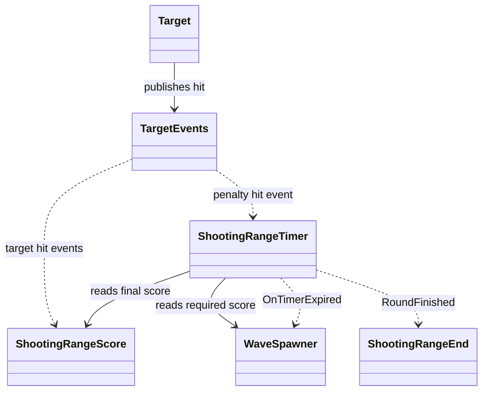
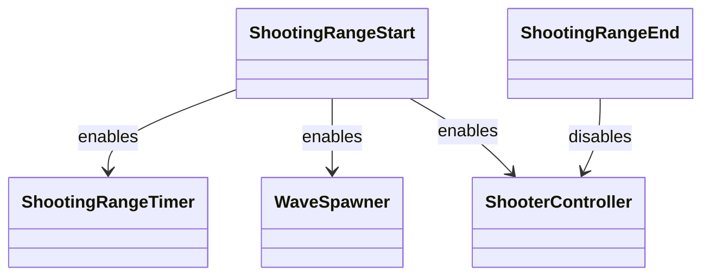
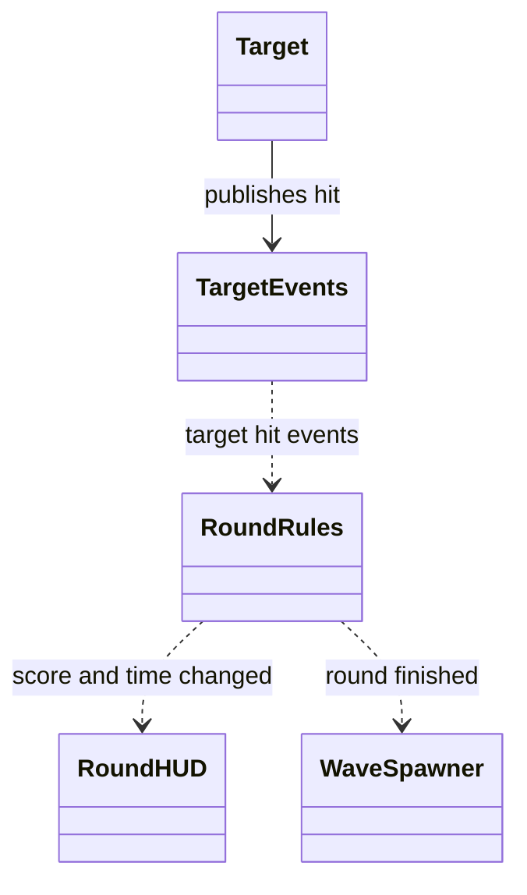

# 🎖️ Ad-Matai — עד מתי?

יום שישי, התיק כבר ארוז, ושער הבסיס ממש מעבר לפינה. ואז המפקד נזכר שיש עוד כמה משימות. **עד מתי?** הוא משחק דו־ממדי קומי לשחקן יחיד, שבו מנסים לסיים את המטלות ולצאת הביתה לפני שסוגרים שבת.

**הגרסה הנוכחית היא אב־טיפוס של המטווח.** היא נפתחת ישירות במשחקון. הצעידה, תורנות המטבח והריצה שמחברת בין המשחקונים מתוארות בהמשך כמתוכננות, ולא כתכונות שכבר מומשו.

- **למשחק בדפדפן ולהורדות:** [Ad-Matai ב־itch.io](https://elonitai.itch.io/ad-matai)
- **קוד המקור:** [GitHub — Ad-Matai](https://github.com/CS-Ariel-GameDev-Project/Ad-Matai)
- **מסמך תכנון השלבים:** [Level Design](Ad_Matai_Level_Design.md)
- **סיפור טויין:**  https://cs-ariel-gamedev-project.github.io/Ad-Matai/     
## 🎯 איך משחקים במטווח

*צילום מסך מתוך סיבוב במטווח.*

1. לוחצים על **Tap to Play** כדי להתחיל. במחשב משתמשים בעכבר, ובטלפון נוגעים במסך.
2. פוגעים במטרות האדומות כשהן מופיעות וצוברים נקודות. פגיעה במטרה ירוקה מורידה **3 שניות** מהטיימר.
3. הסיבוב מתחיל עם **30 שניות**. כשהזמן נגמר, מופיעים הניקוד הסופי ו־**YOU WIN** אם הגעתם ל־**350 נקודות** לפחות, או **GAME OVER**. לחצו על **Play Again** לסיבוב נוסף.

### הערכים בסצנה הנוכחית

הערכים הבאים נבדקו בהגדרות השמורות של `ShootingRangeMG`. הם עשויים להיות שונים מערכי ברירת המחדל שבקוד.

| פרמטר | ערך |
|---|---:|
| משך הסיבוב | 30 שניות |
| סף ניצחון | 350 נקודות |
| ניקוד למטרה אדומה | 10 |
| הפחתת זמן על מטרה ירוקה | 3 שניות |
| הפחתת ניקוד על מטרה ירוקה | 0 |
| מספר מטרות בגל | 3–5 |
| סיכוי לכל מטרה להיות ירוקה | 0.33 |
| השהיה בין גלים | 0.2 שניות |

הגל הבא מתחיל לאחר שכל המטרות האדומות בגל הנוכחי הוסרו. המטרות הירוקות שנותרו מוסרות במעבר בין גלים. הסיבוב מסתיים בעקבות הטיימר; ניצחון אינו מופעל מיד כשעוברים את סף הניקוד.

## ▶️ הרצה מקומית

- **גרסת Unity של הפרויקט שנבדק:** `6000.3.25f1`.
- **סצנת המשחק הנוכחית:** `Assets/Scenes/ShootingRangeMG.unity`.
- **גרסאות להפצה:** Web בדפדפן ו־APK להורדה באנדרואיד.

1. משכפלים את הריפוזיטורי ופותחים את תיקיית הפרויקט דרך Unity Hub.
2. מאפשרים ל־Unity לשחזר את החבילות לפי `Packages/manifest.json`.
3. פותחים את הסצנה `ShootingRangeMG` ולוחצים Play.
4. לוחצים על **Tap to Play** בתוך חלון Game.

הסצנה צריכה להיכלל ברשימת הסצנות לבנייה כדי שכפתור **Play Again** יוכל לטעון אותה מחדש.

## 🧩 מבנה הקוד ואחריות המחלקות

רכיבי המטווח נמצאים ב־`Assets/Scripts/ShootingRangeScripts`.

| מחלקה | אחריות במימוש הנוכחי |
|---|---|
| `Target` | קבלת לחיצה או נגיעה, מניעת פגיעה כפולה, פרסום סוג הפגיעה ומשוב שבירה לפני הסרה |
| `TargetEvents` | הפצת אירועי מטרות ללא הפניה ישירה לניקוד או לטיימר |
| `WaveSpawner` | יצירת מטרות, בחירת מיקומים, מעבר בין גלים וניקוי מטרות בסיום |
| `ShootingRangeScore` | חישוב הניקוד ועדכון טקסט הניקוד |
| `ShootingRangeTimer` | ספירת זמן, עונשי זמן, עדכון תצוגת הזמן ופרסום תוצאת הסיבוב |
| `ShooterController` | החלפה זמנית בין ספרייט חייל רגיל לספרייט ירי בעקבות לחיצה |
| `ShootingRangeStart` | הסתרת מסך ההתחלה והפעלת רכיבי הסיבוב לאחר סיום לחיצת הפתיחה |
| `ShootingRangeEnd` | הצגת תוצאה וניקוד סופי, עצירת משוב הירי וטעינה מחדש בכפתור Play Again |

בתיקיית `Assets/Scripts` נמצאים גם `PlayerMovement`, `CameraFollow`, `CameraOrientationSize`, `FitBackgroundToCamera` ו־`MinimapLayout`. אלה רכיבי תנועה ותצוגה נוספים בפרויקט, ולא חלק מלולאת הלחיצה על מטרות במטווח.

## 📐 תרשימי המחלקות במימוש

### מטרות, אירועים ותוצאה

חץ רציף מציין תלות או קריאה ישירה. חץ מקווקו מציין הודעה באמצעות אירוע, ואינו מציין שהשולח מחזיק הפניה למאזין.

### פתיחה וסיום הסיבוב

`WaveSpawner` יוצר Prefabs שמכילים `Target`. זיהוי הלחיצה מתבצע דרך `IPointerDownHandler`, עם `Collider2D`, רכיב `Physics2DRaycaster` במצלמה ו־EventSystem בסצנה.

`ShooterController` מציג משוב ירי מלחיצות הקלט; הוא אינו פוסק אם נפגעה מטרה. ההכרעה בפגיעה נמצאת ב־`Target`.

## 📣 תקשורת באמצעות אירועים

| שולח | אירוע | מאזין פעיל | תגובה |
|---|---|---|---|
| `Target`, דרך `TargetEvents` | `OnScoreTargetHit` | `ShootingRangeScore` | הוספת ניקוד ועדכון התצוגה |
| `Target`, דרך `TargetEvents` | `OnPenaltyTargetHit` | `ShootingRangeScore` | הפחתת ניקוד לפי ההגדרה; בסצנה הנוכחית ההפחתה היא אפס |
| `Target`, דרך `TargetEvents` | `OnPenaltyTargetHit` | `ShootingRangeTimer` | הפחתת זמן |
| `ShootingRangeTimer` | `OnTimerExpired` | `WaveSpawner` | עצירת יצירה והסרת המטרות שנותרו |
| `ShootingRangeTimer` | `RoundFinished(finalScore, requiredScore)` | `ShootingRangeEnd` | הצגת ניצחון או הפסד והניקוד הסופי |

ההרשמות בקוד המטווח נעשות ב־`OnEnable`, והביטול התואם ב־`OnDisable`.

בסיום הסיבוב הטיימר קורא את הניקוד ואת סף המעבר, משדר קודם `OnTimerExpired` לצורך ניקוי המטרות, ואחר כך `RoundFinished` לצורך הצגת התוצאה.

ב־`TargetEvents` מוגדרים גם `OnTargetMissed` ו־`OnTimePenaltyTriggered`, אך לא נמצאו להם שולחים ומאזינים פעילים בזרימת המטווח שנבדקה. הם אינם מתוארים כאן כתכונות ממומשות.

## 🏗️ החלטות ארכיטקטורה

### 1. רכיבים נפרדים לפי התנהגות

יצירת מטרות, טיפול בפגיעה, ניקוד, זמן, פתיחה, סיום ומשוב הירי מחולקים לרכיבים שונים. החלופה הייתה מחלקת ניהול אחת שעושה הכול. החלוקה הקיימת מאפשרת לשנות את תגובת המטרה או את משך הבזק הירי בלי לשנות את מסך הסיום.

במימוש הנוכחי, רכיבי הניקוד והטיימר מטפלים בחישוב ובעדכון התצוגה שלהם. רכיבי המטרות ומסך הסיום מתקשרים באמצעות אירועים. הרחבה אפשרית היא הפרדת תצוגת הניקוד והזמן לרכיבי UI ייעודיים.
### 2. אירועים במקום הפניה מכל מטרה למאזינים

המטרה מפרסמת אירוע, והניקוד והטיימר מגיבים בנפרד. החלופה הייתה לתת לכל מטרה הפניות ישירות לרכיבים אלה. השימוש באירועים מפחית את התלות של `Target` במערכות שמגיבות לפגיעה.

**הצדקת השימוש ב־static:** `TargetEvents` הוא ערוץ אירועים סטטי למטרות הנוצרות בזמן ריצה. גם `ShootingRangeTimer.OnTimerExpired` הוא אירוע סטטי. הבחירה מאפשרת למטרות ול־Spawner להתחבר בלי חיפוש ידני של כל מופע או חיווט של הפניות בתוך כל Prefab. היא מתאימה להנחה הנוכחית של מטווח פעיל יחיד.

המחיר הוא טווח גלובלי: שני מטווחים פעילים במקביל עלולים להגיב לאותם אירועים. ביטול ההרשמות מצמצם מאזינים ישנים, אך אינו מבודד שני סיבובים מקבילים. במקרה כזה עדיף ערוץ אירועים נפרד לכל סיבוב. אין בסקריפטים שנבדקו דפוס Singleton מותאם אישית. קבועי `const` משמשים לברירות מחדל ולמשמעויות קבועות.

### 3. ערכי משחק ב־Inspector ו־Prefabs משותפים

משך סיבוב, עונשים, ניקוד, קצב הופעה, גבולות האזור וסף הניצחון ניתנים לכוונון ב־Inspector. מטרות אדומות וירוקות משתמשות באותו רכיב `Target`, עם ספרייטים ודגל `isPenaltyTarget` שונים.

החלופה היא קוד נפרד לכל צבע או מספרים מפוזרים בלוגיקה. המימוש הקיים מאפשר לכוון את המשחק בלי לשכפל את קוד הפגיעה. ערכי הסצנה וה־Prefabs הם ההגדרות בפועל, גם כשהם שונים מברירות המחדל בסקריפט.

## 🔍 בדיקת הקוד מול מודל תכנון

### מודל ייחוס להשוואה

התרשים הבא נוצר **בדיעבד לצורך סקירת הארכיטקטורה**. הוא מציג הפרדה מוצעת בין חוקי הסיבוב לממשק, ואינו מוצג כתרשים שנכתב לפני הפיתוח. `RoundRules` ו־`RoundHUD` הם רכיבים מוצעים שאינם קיימים בקוד הנוכחי.

### הבדלים שנמצאו והמשמעות שלהם

| נושא | מודל הייחוס | המימוש בפועל | הסבר ומחיר |
|---|---|---|---|
| הפרדה בין לוגיקה לממשק | `RoundRules` מחשב ניקוד וזמן; `RoundHUD` מאזין ומציג | `ShootingRangeScore` מחשב ניקוד ומעדכן `TextMeshProUGUI`; `ShootingRangeTimer` מנהל זמן ומעדכן טקסט | פחות רכיבים וחיווט באבטיפוס קטן, אבל קיימת תלות של הלוגיקה בממשק. זהו פער מול הפרדה מלאה, ולא דרישה שכבר הושלמה. |
| בעלות על תנאי הניצחון | רכיב חוקים מרכז את חוקי הסיבוב ומפרסם תוצאה | סף המעבר נשמר ב־`WaveSpawner`; הטיימר מחפש אותו ואת רכיב הניקוד באמצעות `FindFirstObjectByType` | שימוש חוזר ברכיבים הקיימים, אך יש פיזור אחריות ותלות בכך שקיים מופע מתאים בסצנה. פיצול עתידי יכול להעביר את הסף ואת התוצאה לרכיב חוקים. |
| היקף האירועים | מערכת מבודדת לכל סיבוב | אירועי המטרות ואירוע פקיעת הזמן סטטיים; `RoundFinished` הוא אירוע של מופע | חיווט פשוט לסיבוב יחיד, במחיר של קושי בבידוד כמה מטווחים באותה סצנה. |
| יכולות עתידיות | ניתן להוסיף טיפול בהחטאה ובעונש זמן דרך ערוצי אירועים ייעודיים | אירועי החטאה ועונש זמן כללי מוגדרים אך אינם מחוברים בזרימה שנבדקה | ריכוז החישוב והתצוגה מפחית את מספר הרכיבים והחיווט באבטיפוס. הפרדה לרכיבי UI ייעודיים תאפשר בהמשך להחליף את התצוגה באופן עצמאי מחוקי הסיבוב. |

הסברים אלה מתארים בדיעבד את הפשרות במבנה הקיים; הם אינם טענה שכך תועדו ההחלטות בזמן הפיתוח.

**גבולות הבדיקה:** **גבולות הבדיקה:** נסקרו שמונת סקריפטי המטווח, חמשת סקריפטי העזר וההגדרות השמורות של סצנת המטווח. הסקירה בחנה אחריות רכיבים, קשרים ואירועים באמצעות קריאת הקוד. בדיקות המשחק נעשו בנפרד באופן ידני.

## ➕ איך מוסיפים סוג מטרה או משחקון

### וריאציה של מטרה קיימת

משכפלים Prefab אדום או ירוק, משנים ספרייט ואת ההגדרות ב־`Target`, ומחברים אותו לשדה המתאים ב־`WaveSpawner`. תגובת הפגיעה נשארת משותפת ואין צורך לשנות קוד. שינוי ניקוד או עונש זמן נעשה בהגדרות `ShootingRangeScore` ו־`ShootingRangeTimer`.

### מטרה שלישית עם התנהגות חדשה

הדגל הבוליאני הקיים מבדיל רק בין מטרה רגילה למטרת עונש. להוספת סוג שלישי צריך להרחיב את הסיווג ב־`Target.cs`, להוסיף את האירוע המתאים ב־`TargetEvents.cs`, ולהוסיף ל־`WaveSpawner.cs` בחירת Prefab ושכיחות לסוג החדש. רכיב הניקוד או הטיימר יאזין לאירוע החדש לפי ההתנהגות הרצויה.

מסך הסיום יכול להישאר כפי שהוא אם חוזה `RoundFinished(finalScore, requiredScore)` נשמר.

### משחקון נוסף

לצעידה או למטבח יתווספו רכיבים וסצנה משלהם. חיבור לריצה משותפת ידרוש חוזה תוצאה משותף ורכיב מעבר בין משחקונים. חיבור זה עדיין מתוכנן ואינו חלק מהמטווח הנוכחי.

## 🧪 פיזיקה והיקף המימוש

המטווח משתמש ב־`Collider2D` לצורך קבלת פגיעות מצביע וב־`Physics2D.OverlapCircle` לניסיון לבחור מיקומי הופעה שאינם חופפים. המצלמה כוללת `Physics2DRaycaster` לצורך מערכת הלחיצות. לאחר מספר ניסיונות מוגבל ה־Spawner משתמש במיקום אקראי חלופי, ולכן מניעת חפיפה אינה מובטחת בכל מצב.

אין בסקריפטי המטווח שנבדקו שימוש מפורש ב־`CharacterController`, ב־`AddForce/AddTorque`, ב־`OnCollisionEnter2D` או בקריאת `Physics2D.Raycast/SphereCast`. `OverlapCircle` וממשק לחיצות אינם מתוארים כאן כתחליף אוטומטי לכל דרישות הפיזיקה. רכיב `PlayerMovement` הנוסף בפרויקט משתמש ב־`Rigidbody2D`, אך אינו חלק מלולאת הירי של הסצנה המתוארת.

דרישות הפיזיקה במטלה נבדקות על פני משחקי הצוות; יש לוודא כיסוי שלהן גם במשחקים האחרים לפני ההגשה.

## 🤖 יומן שימוש ב־AI

| תחום | אופן השימוש |
|---|---|
| תכנון | עזרה בניסוח רעיון המשחק, תכנון משחקונים, פרמטרי קושי ומסמכי Level Design |
| גרפיקה | יצירת תמונות ואסטים לאבטיפוס, לרבות רקע, חייל, מטרות וכוונת, ואיור הקונספט למשחקונים המתוכננים; התמונות שולבו והוגדרו ידנית ביוניטי |
| פיזיקה ומרחב | הסברים על Collider2D, רכיבי תנועה, התאמת רקע למצלמה, יחידות עולם, קנה מידה וזיהוי לחיצות, בנושאים שבהם נדרשה הבנה נוספת |
| קוד וממשק | הסברים להבנת הקוד והקשרים בין הרכיבים, וסיוע באיתור תקלות ובהבנת התיקונים הנדרשים |
| תיעוד וביקורת | ניסוח הערות בקוד ו־README, יצירת תרשימי מחלקות, ובדיקה של ההבדלים בין מודל הייחוס למימוש המתועדים במסמך זה |

ההצעות שולבו בפרויקט ונבדקו ידנית על ידי המפתח. סקירת הארכיטקטורה בחנה את חלוקת האחריות, התקשורת באמצעות אירועים ואפשרויות הרחבה, ותיעדה את ההבדלים בין מודל הייחוס למימוש הנוכחי.

## 🚧 המשחקונים הבאים

| משחקון | מה מתוכנן | סטטוס |
|---|---|---|
| **צעידה** | שולטים בזוג הרגליים שבמרכז השורה ומחליפים בין רגל שמאל לימין לפי הקצב. | בתכנון |
| **תורנות מטבח** | רואים רצף של מאכלים ובוחרים אותם מחדש באותו סדר. | בתכנון |
| **הדרך הביתה** | משלימים את שלושת המשחקונים ברצף כדי לקבל אישור יציאה. כישלון במשימה מסיים את הריצה. | בתכנון |

*איור קונספט לצעידה ולתורנות המטבח, שנוצר באמצעות AI כדי להמחיש את המשחקונים המתוכננים.*
