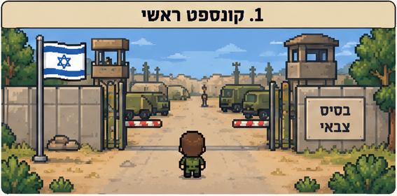
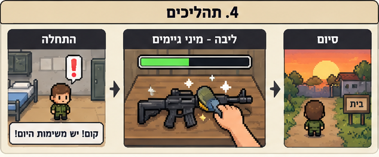
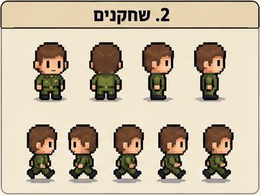

# 🎖️ AD-MATAI — עד מתי?

### עוד משימה אחת ואתה בבית. כנראה.

**משחק 2D קומי על חייל שכל מה שהוא רוצה זה לצאת הביתה — אבל לצה״ל יש תוכניות אחרות.**

`2D` · `Pixel Art` · `Mini-Games` · `Comedy` · `Unity` · `Single Player`

---

## 🏠 עוד רגע יוצאים הביתה... נכון?

יום שישי. התיק כבר ארוז, הראש כבר בסופ״ש, ושער הבסיס נמצא ממש מעבר לפינה.

ואז מגיע המפקד:

> ״רק כמה דברים קטנים לפני שאתה יוצא.״

**ברוכים הבאים ל־Ad-Matai (עד מתי?)** — משחק שבו אתם חיילים בבסיס צבאי, והמשימה החשובה ביותר היא לא להציל את העולם, אלא **להספיק לצאת הביתה לפני שתסגרו שבת**.

תעברו בין המבנים בבסיס, תאספו מטלות מהמפקדים ותנסו להספיק הכול לפני שהשעון ייגמר. נשמע פשוט? חכו שהרס״ר יגלה שלא ניקיתם טוב את הרחבה.

## 🎮 איך משחקים?

המשחק משלב **שני סגנונות משחק** שמשלימים זה את זה:

**🌳 סיור בבסיס — Top-Down Pixel Art**  
מסתובבים בעולם דו־ממדי קטן בסגנון משחקי פוקימון הקלאסיים, מדברים עם מפקדים וחיילים, מחפשים את תחנות המשימה ומחליטים לאן ללכת קודם. כל דקה חשובה.

**⚡ מיני־גיימס — אתגרים מצוירים וקצרים**  
בכל תחנה נכנסים למיני־גיים בעל מכניקה אחרת, עם פעולות פשוטות, אנימציות מוגזמות והומור אבסורדי בהשראת *Dumb Ways to Die* ו־*Rhythm Heaven*. המיני־גיימס עצמם יהיו בסגנון **2D מאויר ולא Pixel Art**.

## 🧽 כל מה שחייל חלם לעשות ביום שישי

| משימה | מה עושים? |
|:---|:---|
| 🔫 **ניקוי נשק** | מנקים כל כתם לפני הביקורת. כן, גם את זה שלא ראיתם. |
| 🥾 **צחצוח נעליים** | מקרצפים עד שהנעליים מבריקות — ומהר. |
| 🧹 **עבודות רס״ר** | מנקים את הרחבה לפני שהרס״ר חוזר למצוא על מה להתלונן. |
| 🍽️ **תורנות מטבח** | שוטפים וממיינים כלים בקצב שהולך ומתגבר. |
| 😴 **שמירה לילית** | מנסים להשאיר את החייל ער, למרות שהכיסא מאוד משכנע. |

## ⏰ המרוץ נגד השבת

הזמן מתקתק גם בזמן שמסתובבים בבסיס וגם במהלך המטלות. הצלחתם? אפשר לסמן וי ולהמשיך. נכשלתם? אולי צריך לנסות שוב — והשעון לא מחכה לאף אחד.

הבחירה שלכם היא לא רק **איך** לבצע את המשימות, אלא גם **באיזה סדר** להתמודד איתן. לרוץ למשימה הקרובה? להיפטר קודם מהקשה? לעצור רגע לדבר עם חייל אחר? כל החלטה יכולה להיות ההבדל בין בית לשבת בבסיס.

## 🚪 שתי דרכים לסיים את היום

- **🎉 יצאת הביתה!** השלמת את כל המטלות והגעת לשער בזמן. החופש מעולם לא הרגיש מתוק יותר.
- **💀 סגרת שבת!** נגמר הזמן? המפקד כבר הכין לך תוכניות לסופ״ש. נסה שוב.

## 🎨 הסגנון והאווירה

העולם של Ad-Matai הוא בסיס צבאי קטן, צבעוני ומלא באופי: מבני מגורים, מטבח, נשקייה, רחבת מסדרים, עמדת שמירה וכמובן — **שער היציאה הנכסף**. הדמויות קטנות ומפוקסלות, בעוד המיני־גיימס עוברים למסכי 2D מצוירים, מלאים בהבעות מוגזמות והפתעות קטנות.

המטרה היא ליצור משחק **קליל, כאוטי, מהיר ומצחיק**, שבו כל מי שהיה בצבא יזהה את האבסורד, וגם מי שלא יוכל ליהנות מאתגרים קצרים ואינטואיטיביים.

## 🛠️ פרטי הפרויקט

- **מנוע:** Unity
- **פלטפורמה מתוכננת:** PC
- **מספר שחקנים:** שחקן יחיד
- **שליטה מתוכננת:** מקלדת ועכבר
- **סוגה:** קומדיה, סיור Top-Down ומיני־גיימס
- **סטטוס:** קונספט / פרויקט בפיתוח במסגרת קורס פיתוח משחקים

> **הערה:** התמונות בעמוד הן **המחשות קונספט שנוצרו באמצעות AI**, ולא צילומי מסך של משחק קיים או של גרסה עובדת. העיצוב, המכניקות והממשק עשויים להשתנות במהלך הפיתוח.

---

### **AD-MATAI**

*השעון מתקתק. הרס״ר בדרך. הבית מחכה.*

**רק אל תסגור שבת.**

